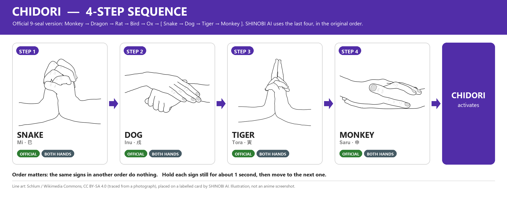
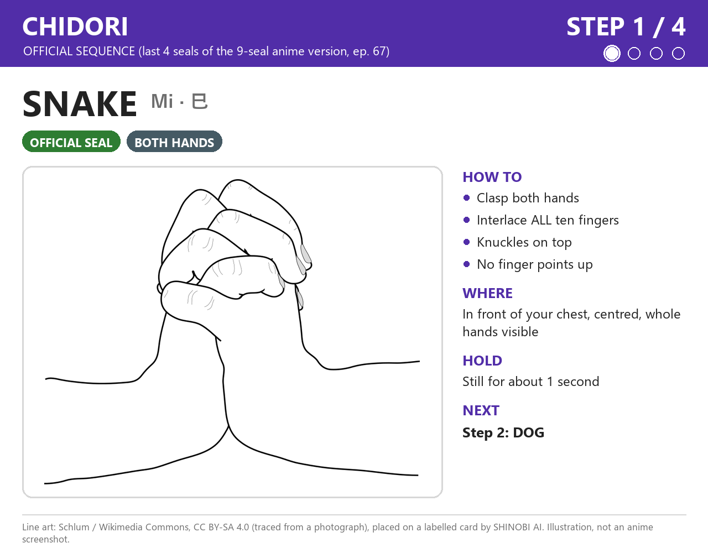
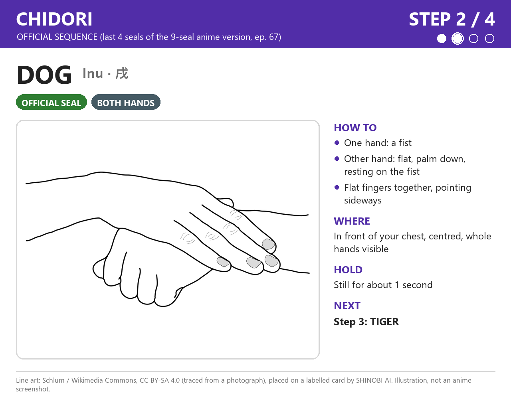
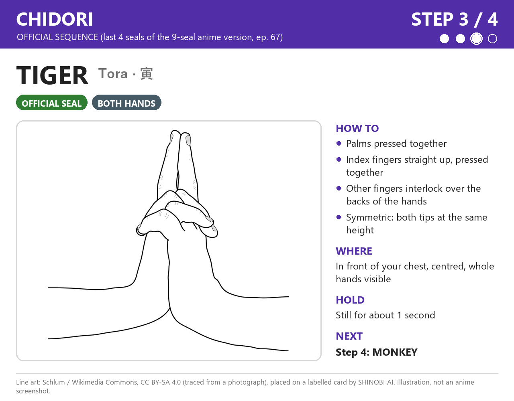
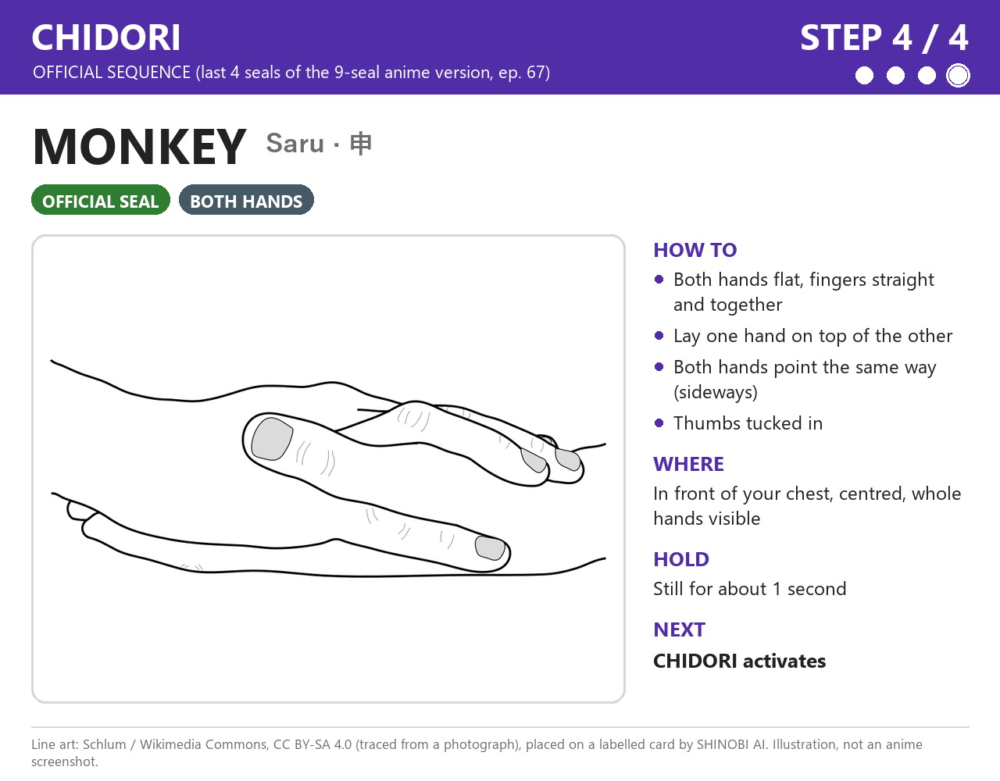

# Chidori — 千鳥

[⬅ كل الـ jutsu](../README.md)

**الحالة: رسمي (Official).** الـ 4 حركات دول هما **آخر 4 seals ورا بعض** من نسخة رسمية فيها 9 seals، **بنفس ترتيبهم**.

- [Narutopedia](https://naruto.fandom.com/wiki/Chidori) بيذكر تسلسلين للـ Chidori:
  - **نسخة الـ 9 seals:** Monkey → Dragon → Rat → Bird → Ox → **Snake → Dog → Tiger → Monkey**. مرجعها أنمي حلقة 67.
  - **نسخة الـ 3 seals:** Ox → Rabbit → Monkey. مرجعها أنمي حلقة 134.
- **ليه اخترنا من نسخة الـ 9؟** قاعدتنا: لو فيه 4 seals أو أكتر ورا بعض، ناخد 4 ورا بعض بنفس الترتيب. نسخة الـ 3 seals أقصر من 4، فأخدنا **آخر 4** من النسخة الطويلة.
- **التسلسلين الاتنين مرجعهم حلقات أنمي، مش المانجا.**
- أول ظهور للـ Chidori: مانجا فصل 113، أنمي حلقة 67.

> الصور هنا **رسومات توضيحية (illustrations)** معمولة من رسومات خطية على Wikimedia Commons، والرسومات دي اتعملت من صور فوتوغرافية. **مش screenshots من الأنمي.**

---

## نظرة سريعة



**Step 1 (Snake) → Step 2 (Dog) → Step 3 (Tiger) → Step 4 (Monkey) → Jutsu Activation**

**الترتيب مهم:** Chidori و Fire الاتنين فيهم Monkey و Tiger. في Chidori الـ **Tiger قبل Monkey**، وفي Fire الـ **Monkey في الأول و Tiger في الآخر**. البرنامج لازم يفرّق بالترتيب، مش بالحركات بس.

---

## قبل ما نبدأ: الكاميرا

| | |
|---|---|
| المسافة | نقعد على بعد حوالي **50–70 سم** من اللابتوب |
| مكان الإيدين | **قدام الصدر**، في **نص الصورة** |
| الإيدين | يبانوا **كاملين** في الصورة، من غير صوابع طالعة برّه |
| النور | يبقى **من قدام**. **مانقعدش والشباك ورانا**، لأن النور اللي ورا بيخلي الإيد غامقة والصوابع مش باينة |
| الإيدين في الحركات دي | كل الحركات الأربعة **بالإيدين الاتنين** |
| نفس الشكل كل مرة | نختار مرة واحدة أنهي إيد القبضة في Dog، وأنهي إيد فوق في Monkey، **ومانغيّرش**. الموديل هيتعلم اللي هنسجّله |

الرسومات ممكن تكون متصورة من زاوية مختلفة عن زاوية الكاميرا. المهم **شكل الصوابع**. نوجّه الإيدين ناحية الكاميرا بحيث الصوابع تبان.

---

## Step 1 — Snake (Mi · 巳)



- **الإيدين:** الاتنين.
- **الصوابع:** نشبّك **كل** الصوابع في بعض، زي ما بنمسك إيدنا في إيدنا بقوة. **مافيش ولا صباع واقف لفوق.**
- **الاتجاه:** الإيدين ماسكين بعض، و**المفاصل (knuckles) فوق**.
- **المكان:** قدام الصدر، في نص الصورة.
- **المدة:** نثبّت الحركة حوالي **ثانية** (قيمة مخططة).

**أخطاء شائعة**
- صباع واقف لفوق. كده الحركة بتقرّب من Tiger.
- الكفين لازقين في بعض من غير ما الصوابع تتشبّك. ده شبه التصفيق، مش Snake.

**الانتقال لـ Step 2 (Dog):** نفك التشبيك. إيد تقفل **قبضة**، والتانية تتفرد وتنام **فوق القبضة**، والكف لتحت.

---

## Step 2 — Dog (Inu · 戌)



- **الإيدين:** الاتنين.
- **الصوابع:** إيد مقفولة **قبضة**. الإيد التانية **مفرودة**، والصوابع **لازقة في بعض**.
- **اتجاه الكف:** الإيد المفرودة **الكف بتاعها لتحت**، ونايمة **فوق القبضة**، والصوابع **بتشاور لجنب**.
- **المكان:** قدام الصدر.
- **المدة:** حوالي **ثانية** (مخططة).

**أخطاء شائعة**
- الإيد اللي فوق مش مفرودة.
- القبضة مستخبية خالص ورا الإيد المفرودة.
- الصوابع متباعدة.

**الانتقال لـ Step 3 (Tiger):** نرفع الإيدين، ونلزّق الكفين في بعض، ونشبّك الصوابع، ونرفع السبابتين **لفوق** لازقين في بعض.

---

## Step 3 — Tiger (Tora · 寅)



- **الإيدين:** الاتنين.
- **الصوابع:** **الكفين لازقين في بعض**. **السبابتين** واقفين **مستقيم لفوق** ولازقين في بعض. باقي الصوابع **متشابكة فوق ظهر الإيدين**. فيه مراجع بترفع **السبابة والوسطى** مع بعض. إحنا بنمشي على الرسمة، ونفضل على نفس الشكل كل مرة.
- **الاتجاه:** الصوابع الواقفة بتشاور **للسقف**. الإيدين **متماثلين** (نفس الشكل بالظبط).
- **المكان:** قدام الصدر، مش قدام الوش.
- **المدة:** حوالي **ثانية** (مخططة).

**أخطاء شائعة**
- الصوابع الواقفة مايلة أو مثنية.
- الخلط مع Ram: في **Tiger** الإيدين متشابكين **بالتساوي** والصوابع الواقفة **نفس الطول**. في **Ram** إيد **قدام** التانية والصوابع الواقفة **مش نفس الطول**.
- الخلط مع Horse: لو السبابتين بيلمسوا من الطرف بس وعاملين مثلث، تبقى دي Horse مش Tiger.

**الانتقال لـ Step 4 (Monkey):** نفك التشبيك، ونفرد الإيدين، ونيّمهم **بالعرض**، ونحط إيد **فوق التانية** والصوابع بتشاور لنفس الناحية.

---

## Step 4 — Monkey (Saru · 申)



- **الإيدين:** الاتنين.
- **الصوابع:** الإيدين مفرودين، والصوابع **مفرودة ولازقة في بعض** (مش متباعدة). الإبهامين لازقين في جنب الإيد، مش طالعين لبرّه.
- **اتجاه الكف:** الإيدين **نايمين بالعرض**. إيد **نايمة فوق التانية**، والصوابع في الإيدين **بتشاور لنفس الناحية** (لجنب). فيه دليل على النت بيقول الكف اليمين فوق الشمال. نختار ترتيب واحد ونلتزم بيه.
- **المكان:** قدام الصدر، في نص الصورة.
- **المدة:** حوالي **ثانية** (مخططة).

**أخطاء شائعة**
- الصوابع متباعدة بدل ما تكون لازقة.
- الإيدين متقاطعين على شكل X، بدل ما يبقوا فوق بعض وبيشاوروا لنفس الناحية.
- الإيد اللي فوق مغطية اللي تحت خالص، فالكاميرا شايفة إيد واحدة بس.

**بعد Step 4:** نثبّت Monkey لحد ما الـ jutsu يشتغل.

---

## خطة التمرين

1. **كل حركة لوحدها ببطء:** نبص على صورة الخطوة، ونعمل الحركة، ونثبّتها **3 ثواني**. نعمل ده للأربع حركات.
2. **أسرع شوية:** نفس الكلام، بس كل حركة **ثانية واحدة**.
3. **التسلسل كله:** Snake → Dog → Tiger → Monkey ورا بعض، في **أقل من حوالي 10 ثواني**.
4. **قدام الكاميرا:** نشغّل البرنامج ونشوف نقط الإيد:

   ```powershell
   .venv\Scripts\python.exe -m shinobi.main
   ```

   - لو النقط مش ظاهرة، ندوس `L`.
   - البرنامج **لسه مش بيتعرف** على الـ seals دي. النقط بس بتورينا الكاميرا شايفة إيدينا ولا لأ. ولما الصوابع تبقى متشابكة، طبيعي النقط تتلخبط شوية.
   - **قبلها نقفل أداة التسجيل** (`Q`) لو كانت مفتوحة، لأن الكاميرا مش بتشتغل مع برنامجين في نفس الوقت.

---

## قواعد التوقيت (مخططة، **لسه مش متنفذة**)

| القاعدة | القيمة المخططة |
|---|---|
| نثبّت كل حركة لحد ما تتحسب | حوالي **ثانية** |
| الحركة اللي بعدها لازم تبدأ في خلال | حوالي **3 ثواني**، وإلا التقدّم يرجع للصفر |
| لو ثبّتنا حركة غلط (مش الخطوة الجاية) | التقدّم في الـ jutsu ده يرجع للصفر |
| الحركات اللي في النص وإحنا بنغيّر شكل الإيد | مش بتتحسب، لأنها مش ثابتة |
| بعد ما أي jutsu يشتغل | **كل** التقدّم في **كل** الـ jutsu يتصفّر، وفيه **cooldown** قبل ما يشتغل تاني |

**مثال:** Chidori بيخلص بـ Monkey، و Fire بيبدأ بـ Monkey. بعد ما Chidori يشتغل كل حاجة بتتصفّر، فالـ Monkey اللي في آخر Chidori **مش هيتحسب** Step 1 في Fire.

الأرقام دي لسه هتتظبط وتتجرب لما نبني جزء التعرّف على التسلسل.

---

## المصادر

- [Narutopedia: Chidori](https://naruto.fandom.com/wiki/Chidori): التسلسلين: "Ox, Rabbit, Monkey" (أنمي حلقة 134)، و "Monkey, Dragon, Rat, Bird, Ox, Snake, Dog, Tiger, Monkey" (أنمي حلقة 67). أول ظهور: مانجا فصل 113، أنمي حلقة 67.
- [Narutopedia: Hand Seal](https://naruto.fandom.com/wiki/Hand_Seal): الـ 12 seal الأساسيين.

إحنا ماشفناش الحلقات دي بنفسنا. اعتمدنا على المراجع اللي فوق.

---

## حقوق الصور

| الخطوة | الرسمة الأصلية |
|---|---|
| Step 1: Snake | [Mudra-Naruto-Serpent.svg](https://commons.wikimedia.org/wiki/File:Mudra-Naruto-Serpent.svg) |
| Step 2: Dog | [Mudra-Naruto-Chien.svg](https://commons.wikimedia.org/wiki/File:Mudra-Naruto-Chien.svg) |
| Step 3: Tiger | [Mudra-Naruto-Tigre.svg](https://commons.wikimedia.org/wiki/File:Mudra-Naruto-Tigre.svg) |
| Step 4: Monkey | [Mudra-Naruto-Singe.svg](https://commons.wikimedia.org/wiki/File:Mudra-Naruto-Singe.svg) |

الرسومات من رسم **Schlum** على Wikimedia Commons (معمولة من صور فوتوغرافية)، بترخيص [CC BY-SA 4.0](https://creativecommons.org/licenses/by-sa/4.0/). إحنا قصّيناها وحطيناها على كروت فيها أرقام وأسماء وشرح، فصور الخطوات وصورة التسلسل برضه **CC BY-SA 4.0**.
