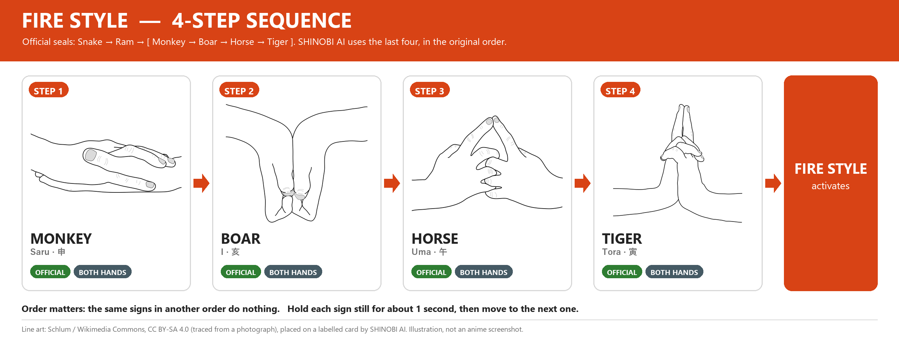
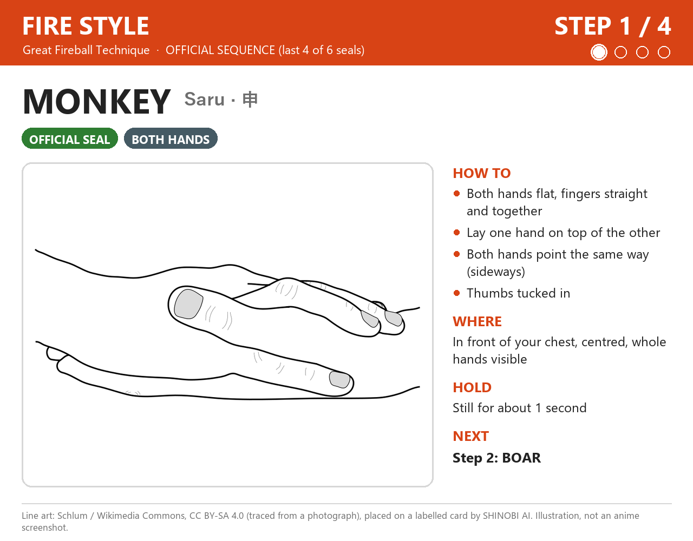
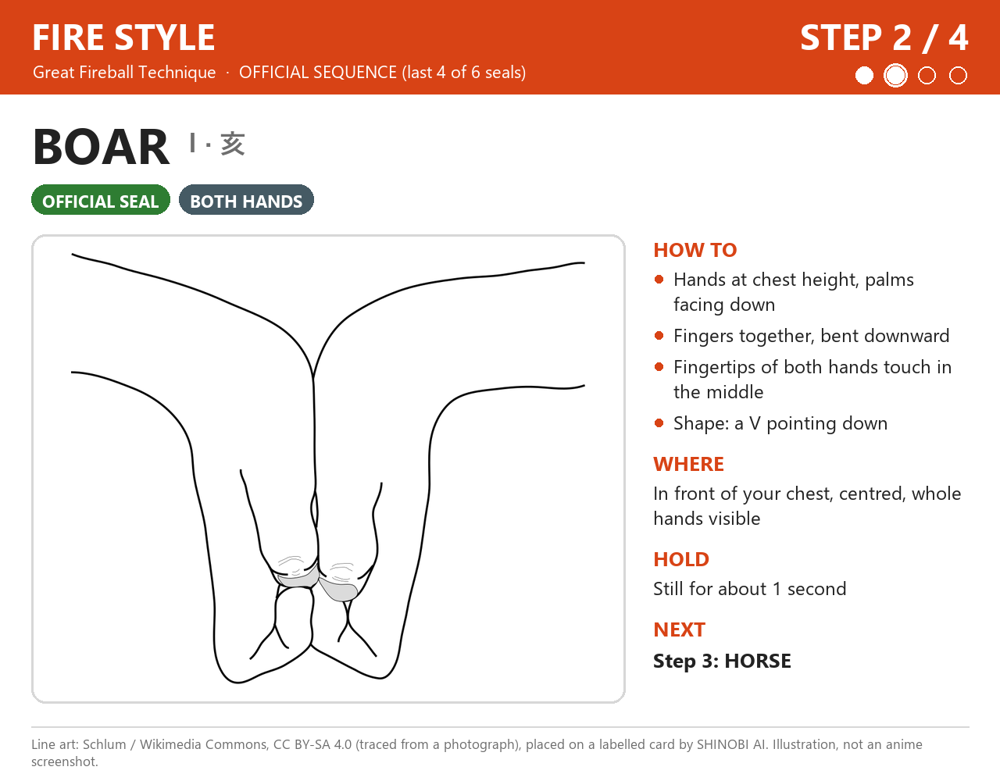
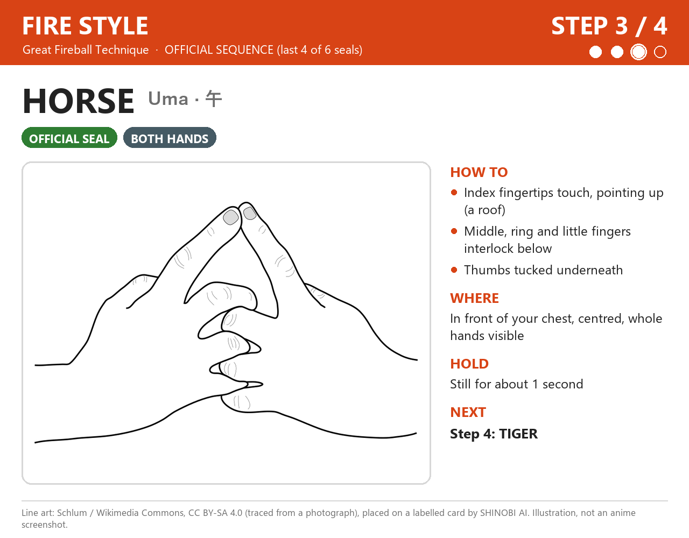
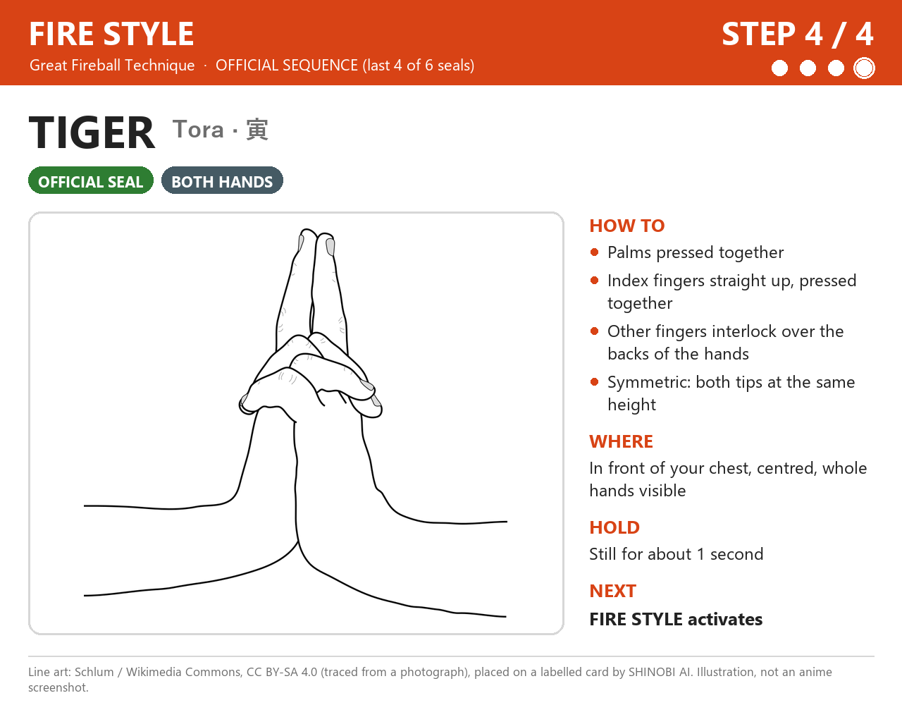

# Fire Style: Great Fireball — 火遁・豪火球の術 (Katon: Gōkakyū no Jutsu)

[⬅ كل الـ jutsu](../README.md)

**الحالة: رسمي (Official).** الـ 4 حركات دول هما **آخر 4 seals ورا بعض** من التسلسل الرسمي، **بنفس ترتيبهم**.

- **التسلسل الرسمي كامل (6 seals):** Snake → Ram → **Monkey → Boar → Horse → Tiger**. المرجع: [Narutopedia](https://naruto.fandom.com/wiki/Fire_Release:_Great_Fireball_Technique). أول ظهور للـ jutsu: مانجا فصل 7، أنمي حلقة 5.
- **ليه 4 بس؟** كل jutsu في المشروع 4 خطوات، عشان يبقى أقصر وأسهل قدام الكاميرا. أخدنا آخر 4 ورا بعض من غير ما نغيّر الترتيب.
- جدول [jutsu.csv](https://github.com/Kazuhito00/NARUTO-HandSignDetection/blob/main/setting/jutsu.csv) في مشروع NARUTO-HandSignDetection فيه نسختين للتسلسل ده: واحدة زي Narutopedia، وواحدة فيها Tiger مكان Ram في الخطوة التانية. **آخر 4 seals واحدة في النسختين**، فاختيارنا مش متأثر بالفرق ده.
- Narutopedia بيقول إن الـ Fire Release غالباً بيخلص بـ Tiger ([Hand Seal](https://naruto.fandom.com/wiki/Hand_Seal)). وعندنا Step 4 هي Tiger فعلاً.

> الصور هنا **رسومات توضيحية (illustrations)** معمولة من رسومات خطية على Wikimedia Commons، والرسومات دي اتعملت من صور فوتوغرافية. **مش screenshots من الأنمي.**

---

## نظرة سريعة



**Step 1 (Monkey) → Step 2 (Boar) → Step 3 (Horse) → Step 4 (Tiger) → Jutsu Activation**

---

## قبل ما نبدأ: الكاميرا

| | |
|---|---|
| المسافة | نقعد على بعد حوالي **50–70 سم** من اللابتوب |
| مكان الإيدين | **قدام الصدر**، في **نص الصورة** |
| الإيدين | يبانوا **كاملين** في الصورة، من غير صوابع طالعة برّه |
| النور | يبقى **من قدام**. **مانقعدش والشباك ورانا**، لأن النور اللي ورا بيخلي الإيد غامقة والصوابع مش باينة |
| الإيدين في الحركات دي | كل الحركات الأربعة **بالإيدين الاتنين** |
| نفس الشكل كل مرة | نختار مرة واحدة أنهي إيد فوق في Monkey، **ومانغيّرش**. الموديل هيتعلم اللي هنسجّله |

الرسومات ممكن تكون متصورة من زاوية مختلفة عن زاوية الكاميرا. المهم **شكل الصوابع**. نوجّه الإيدين ناحية الكاميرا بحيث الصوابع تبان.

---

## Step 1 — Monkey (Saru · 申)



- **الإيدين:** الاتنين.
- **الصوابع:** الإيدين مفرودين، والصوابع **مفرودة ولازقة في بعض** (مش متباعدة). الإبهامين لازقين في جنب الإيد، مش طالعين لبرّه.
- **اتجاه الكف:** الإيدين **نايمين بالعرض**. إيد **نايمة فوق التانية**، والصوابع في الإيدين **بتشاور لنفس الناحية** (لجنب). فيه دليل على النت بيقول الكف اليمين فوق الشمال. نختار ترتيب واحد ونلتزم بيه.
- **المكان:** قدام الصدر، في نص الصورة.
- **المدة:** نثبّت الحركة حوالي **ثانية** (قيمة مخططة).

**أخطاء شائعة**
- الصوابع متباعدة بدل ما تكون لازقة.
- الإيدين متقاطعين على شكل X، بدل ما يبقوا فوق بعض وبيشاوروا لنفس الناحية.
- الإيد اللي فوق مغطية اللي تحت خالص، فالكاميرا شايفة إيد واحدة بس.

**الانتقال لـ Step 2 (Boar):** نشيل الإيد اللي فوق، ونلف الكفين **لتحت**، ونثني الصوابع لتحت، ونقرّب الإيدين لحد ما أطراف الصوابع تلمس بعض في النص.

---

## Step 2 — Boar (I · 亥)



- **الإيدين:** الاتنين.
- **الصوابع:** في كل إيد الصوابع **لازقة في بعض ومثنية لتحت**.
- **اتجاه الكف:** الكفوف **بتبص لتحت** (ناحية الأرض).
- **الشكل:** أطراف الصوابع والمفاصل بتاعة الإيدين **بيلمسوا بعض في النص**، فالإيدين بيعملوا حرف **V بيشاور لتحت**.
- **المكان:** قدام الصدر.
- **المدة:** حوالي **ثانية** (مخططة).

**أخطاء شائعة**
- الإيدين بعاد عن بعض ومش لامسين.
- الصوابع مفرودة على الآخر بدل ما تكون مثنية لتحت.
- في مشروع NARUTO-HandSignDetection، Boar و Rat من أكتر الحركات اللي بتتلخبط في بعض. إحنا مش بنستخدم Rat، بس لازم شكل Boar يبقى واضح زي الرسمة.

**الانتقال لـ Step 3 (Horse):** نلف الإيدين **لفوق**، ونشبّك الوسطى والبنصر والخنصر في بعض، ونرفع السبابتين يلمسوا بعض من الطرف لفوق، والإبهامين تحت.

---

## Step 3 — Horse (Uma · 午)



- **الإيدين:** الاتنين.
- **الصوابع:** طرف **السبابة اليمين يلمس طرف السبابة الشمال**، والاتنين بيشاوروا **لفوق** زي سقف أو مثلث. **الوسطى والبنصر والخنصر** في الإيدين **متشابكين** في بعض تحت. **الإبهامين تحت**.
- **الاتجاه:** المثلث اللي عاملينه السبابتين يبقى **باين للكاميرا**.
- **المكان:** قدام الصدر.
- **المدة:** حوالي **ثانية** (مخططة).

**أخطاء شائعة**
- السبابتين مش لامسين بعض من الطرف.
- الصوابع التانية مفرودة بدل ما تكون متشابكة.
- الخلط مع Tiger: في **Horse** السبابتين **بيلمسوا من الطرف بس** وبيعملوا مثلث. في **Tiger** الصوابع الواقفة **لازقة جنب بعض بطولها** ومستقيمة.

**الانتقال لـ Step 4 (Tiger):** نلزّق الكفين في بعض، ونلزّق السبابتين جنب بعض بطولهم ونخليهم واقفين **مستقيم لفوق** بدل المثلث. الصوابع التانية تفضل متشابكة.

---

## Step 4 — Tiger (Tora · 寅)



- **الإيدين:** الاتنين.
- **الصوابع:** **الكفين لازقين في بعض**. **السبابتين** واقفين **مستقيم لفوق** ولازقين في بعض. باقي الصوابع **متشابكة فوق ظهر الإيدين**. فيه مراجع بترفع **السبابة والوسطى** مع بعض. إحنا بنمشي على الرسمة، ونفضل على نفس الشكل كل مرة.
- **الاتجاه:** الصوابع الواقفة بتشاور **للسقف**. الإيدين **متماثلين** (نفس الشكل بالظبط).
- **المكان:** قدام الصدر، مش قدام الوش.
- **المدة:** حوالي **ثانية** (مخططة).

**أخطاء شائعة**
- الصوابع الواقفة مايلة أو مثنية.
- الخلط مع Ram: في **Tiger** الإيدين متشابكين **بالتساوي** والصوابع الواقفة **نفس الطول**. في **Ram** إيد **قدام** التانية والصوابع الواقفة **مش نفس الطول**.
- الخلط مع Horse: لو السبابتين بيلمسوا من الطرف بس وعاملين مثلث، تبقى دي Horse مش Tiger.

**بعد Step 4:** نثبّت Tiger لحد ما الـ jutsu يشتغل.

---

## خطة التمرين

1. **كل حركة لوحدها ببطء:** نبص على صورة الخطوة، ونعمل الحركة، ونثبّتها **3 ثواني**. نعمل ده للأربع حركات.
2. **أسرع شوية:** نفس الكلام، بس كل حركة **ثانية واحدة**.
3. **التسلسل كله:** Monkey → Boar → Horse → Tiger ورا بعض، في **أقل من حوالي 10 ثواني**.
4. **قدام الكاميرا:** نشغّل البرنامج ونشوف نقط الإيد:

   ```powershell
   .venv\Scripts\python.exe -m shinobi.main
   ```

   - لو النقط مش ظاهرة، ندوس `L`.
   - البرنامج **لسه مش بيتعرف** على الـ seals دي. النقط بس بتورينا الكاميرا شايفة إيدينا ولا لأ. ولما الصوابع تبقى متشابكة، طبيعي النقط تتلخبط شوية.
   - **قبلها نقفل أداة التسجيل** (`Q`) لو كانت مفتوحة، لأن الكاميرا مش بتشتغل مع برنامجين في نفس الوقت.

---

## قواعد التوقيت (مخططة، **لسه مش متنفذة**)

| القاعدة | القيمة المخططة |
|---|---|
| نثبّت كل حركة لحد ما تتحسب | حوالي **ثانية** |
| الحركة اللي بعدها لازم تبدأ في خلال | حوالي **3 ثواني**، وإلا التقدّم يرجع للصفر |
| لو ثبّتنا حركة غلط (مش الخطوة الجاية) | التقدّم في الـ jutsu ده يرجع للصفر |
| الحركات اللي في النص وإحنا بنغيّر شكل الإيد | مش بتتحسب، لأنها مش ثابتة |
| بعد ما أي jutsu يشتغل | **كل** التقدّم في **كل** الـ jutsu يتصفّر، وفيه **cooldown** قبل ما يشتغل تاني |

**مثال:** Chidori بيخلص بـ Monkey، و Fire بيبدأ بـ Monkey. بعد ما Chidori يشتغل كل حاجة بتتصفّر، فالـ Monkey ده **مش هيتحسب** Step 1 في Fire. عشان نعمل Fire بعدها، نستنى الـ cooldown ونبدأ من Monkey من الأول.

الأرقام دي لسه هتتظبط وتتجرب لما نبني جزء التعرّف على التسلسل.

---

## المصادر

- [Narutopedia: Fire Release: Great Fireball Technique](https://naruto.fandom.com/wiki/Fire_Release:_Great_Fireball_Technique): التسلسل الرسمي (Snake, Ram, Monkey, Boar, Horse, Tiger). أول ظهور: مانجا فصل 7، أنمي حلقة 5.
- [Narutopedia: Hand Seal](https://naruto.fandom.com/wiki/Hand_Seal): الـ 12 seal الأساسيين، وإن الـ Fire Release غالباً بيخلص بـ Tiger.
- [NARUTO-HandSignDetection: jutsu.csv](https://github.com/Kazuhito00/NARUTO-HandSignDetection/blob/main/setting/jutsu.csv): فيه نسختين لـ Fireball Jutsu: 巳 寅 申 亥 午 寅 و 巳 未 申 亥 午 寅.

إحنا ماشفناش الفصل والحلقة دول بنفسنا. اعتمدنا على المراجع اللي فوق.

---

## حقوق الصور

| الخطوة | الرسمة الأصلية |
|---|---|
| Step 1: Monkey | [Mudra-Naruto-Singe.svg](https://commons.wikimedia.org/wiki/File:Mudra-Naruto-Singe.svg) |
| Step 2: Boar | [Mudra-Naruto-Cochon.svg](https://commons.wikimedia.org/wiki/File:Mudra-Naruto-Cochon.svg) |
| Step 3: Horse | [Mudra-Naruto-Cheval.svg](https://commons.wikimedia.org/wiki/File:Mudra-Naruto-Cheval.svg) |
| Step 4: Tiger | [Mudra-Naruto-Tigre.svg](https://commons.wikimedia.org/wiki/File:Mudra-Naruto-Tigre.svg) |

الرسومات من رسم **Schlum** على Wikimedia Commons (معمولة من صور فوتوغرافية)، بترخيص [CC BY-SA 4.0](https://creativecommons.org/licenses/by-sa/4.0/). إحنا قصّيناها وحطيناها على كروت فيها أرقام وأسماء وشرح، فصور الخطوات وصورة التسلسل برضه **CC BY-SA 4.0**.
