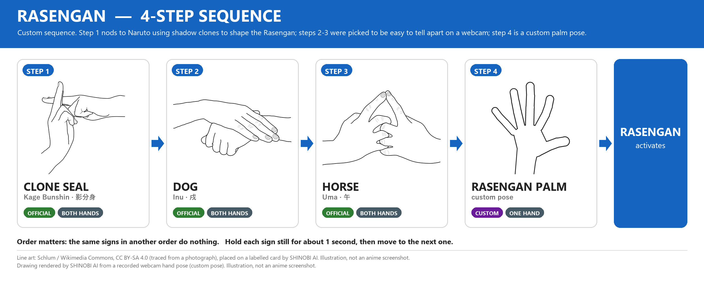
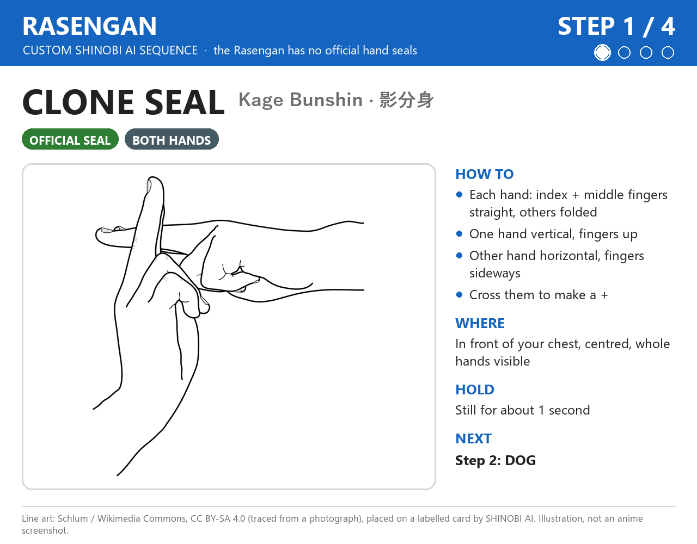
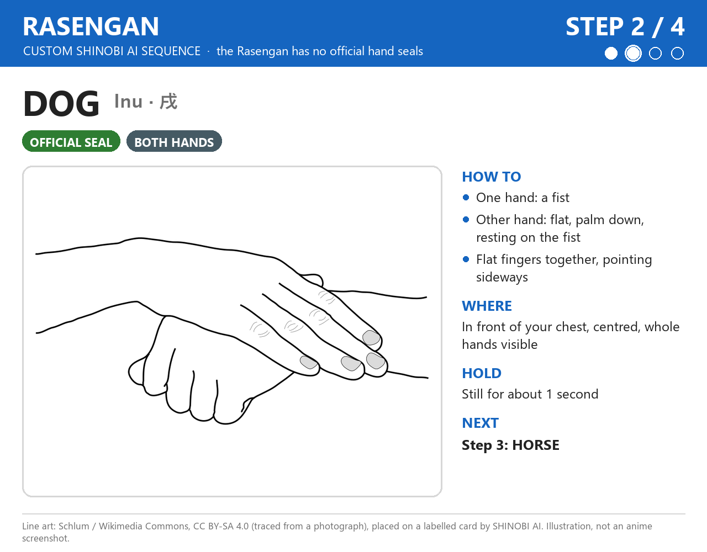
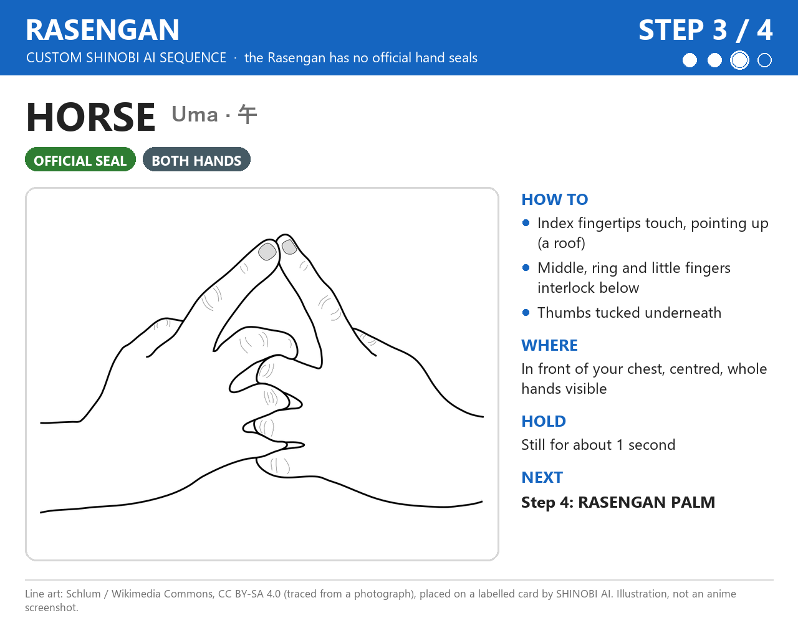
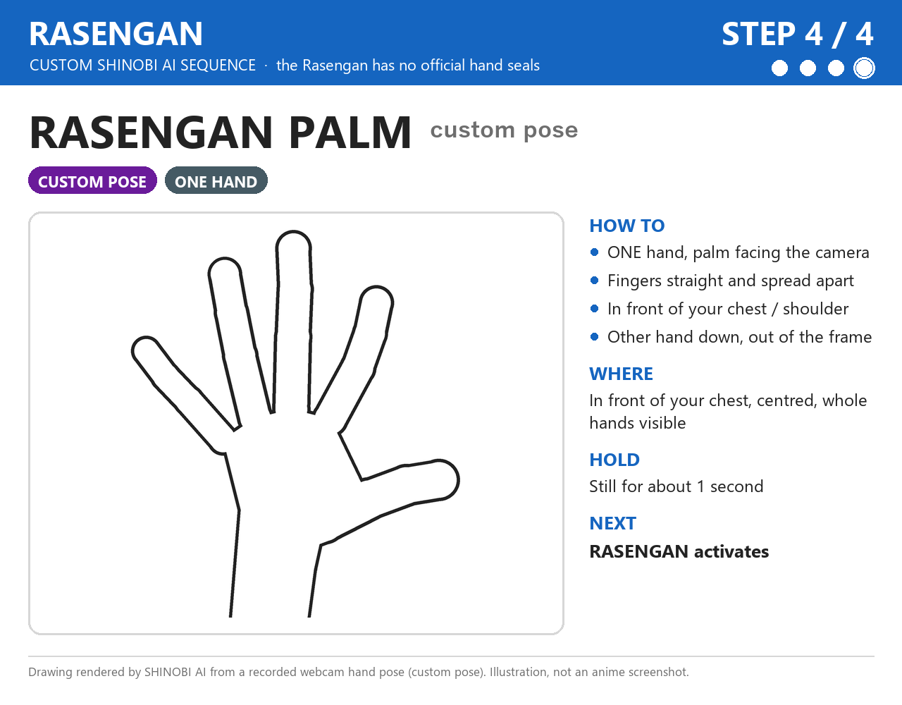

# Rasengan — 螺旋丸

[⬅ كل الـ jutsu](../README.md)

**الحالة: مخصص (Custom) لـ SHINOBI AI.** التسلسل ده **مش رسمي**. إحنا اللي عملناه كله.

- **الـ Rasengan رسمياً مالوش hand seals خالص.** [Narutopedia](https://naruto.fandom.com/wiki/Rasengan) بيقول: "No hand seals are involved" (مانجا فصل 151 و 155). أول ظهور: مانجا فصل 150، أنمي حلقة 86.
- عشان كده عملنا تسلسل custom من 4 خطوات:
  - **Step 1 (Clone seal):** مستوحاة من إن Naruto في الأول كان بيستخدم shadow clones تساعده يمسك الـ chakra ويشكّل الـ Rasengan ([Narutopedia](https://naruto.fandom.com/wiki/Rasengan)، مانجا فصل 167).
  - **Steps 2-3 (Dog → Horse):** **مالهمش أي معنى في القصة.** اخترناهم لأنهم حركتين بالإيدين الاتنين، وشكلهم مختلف عن بعض، وبيدّوا Rasengan ترتيب مش موجود في أي jutsu تاني.
  - **Step 4 (Rasengan palm):** **مش hand seal.** ده pose إحنا اللي عملناه: كف مفتوح قدام الكاميرا، لأن الـ Rasengan بيتكوّن في الكف (Narutopedia: الـ chakra بتطلع من الكف، مانجا فصل 155).

> صور Steps 1-3 **رسومات توضيحية (illustrations)** معمولة من رسومات خطية على Wikimedia Commons، والرسومات دي اتعملت من صور فوتوغرافية. صورة Step 4 **رسمة بتاعتنا** معمولة من نقط إيدك المتسجلة. **مفيش ولا صورة screenshot من الأنمي.**

---

## نظرة سريعة



**Step 1 (Clone seal) → Step 2 (Dog) → Step 3 (Horse) → Step 4 (Rasengan palm) → Jutsu Activation**

---

## قبل ما نبدأ: الكاميرا

| | |
|---|---|
| المسافة | نقعد على بعد حوالي **50–70 سم** من اللابتوب |
| مكان الإيدين | **قدام الصدر**، في **نص الصورة** |
| الإيدين | يبانوا **كاملين** في الصورة، من غير صوابع طالعة برّه |
| النور | يبقى **من قدام**. **مانقعدش والشباك ورانا**، لأن النور اللي ورا بيخلي الإيد غامقة والصوابع مش باينة |
| الإيدين في الحركات دي | Steps 1-3 **بالإيدين الاتنين**. Step 4 **بإيد واحدة**، والإيد التانية **تنزل تحت برّه الصورة** |
| نفس الشكل كل مرة | نختار مرة واحدة أنهي إيد بتقف في Clone seal، وأنهي إيد القبضة في Dog، **ومانغيّرش**. الموديل هيتعلم اللي هنسجّله |

الرسومات ممكن تكون متصورة من زاوية مختلفة عن زاوية الكاميرا. المهم **شكل الصوابع**. نوجّه الإيدين ناحية الكاميرا بحيث الصوابع تبان.

---

## Step 1 — Clone seal (Kage Bunshin · 影分身)



- **الإيدين:** الاتنين.
- **الصوابع:** في كل إيد: **السبابة والوسطى مفرودين ولازقين في بعض**، والبنصر والخنصر مثنيين، والإبهام ماسكهم.
- **الاتجاه:** إيد **واقفة** (الصباعين بيشاوروا لفوق)، والتانية **بالعرض** (الصباعين بيشاوروا لجنب). نحط الصباعين اللي بالعرض على اللي واقفين، فيعملوا علامة **+** زي الرسمة.
- **المكان:** قدام الصدر، العلامة في نص الصورة، والإيدين الاتنين باينين كاملين.
- **المدة:** نثبّت الحركة حوالي **ثانية** (قيمة مخططة).

**أخطاء شائعة**
- البنصر والخنصر مفتوحين بدل ما يكونوا مقفولين.
- السبابة والوسطى متباعدين عن بعض.
- الإيد اللي بالعرض مغطية الإيد الواقفة خالص.
- العلامة قدام الوش بدل الصدر.

**الانتقال لـ Step 2 (Dog):** نفك العلامة **+**. إيد تقفل **قبضة**، والتانية تتفرد وتنام **فوق القبضة**، والكف لتحت.

---

## Step 2 — Dog (Inu · 戌)



- **الإيدين:** الاتنين.
- **الصوابع:** إيد مقفولة **قبضة**. الإيد التانية **مفرودة**، والصوابع **لازقة في بعض**.
- **اتجاه الكف:** الإيد المفرودة **الكف بتاعها لتحت**، ونايمة **فوق القبضة**، والصوابع **بتشاور لجنب**.
- **المكان:** قدام الصدر.
- **المدة:** حوالي **ثانية** (مخططة).

**أخطاء شائعة**
- الإيد اللي فوق مش مفرودة.
- القبضة مستخبية خالص ورا الإيد المفرودة.
- الصوابع متباعدة.

**الانتقال لـ Step 3 (Horse):** نرفع الإيدين، ونشبّك الوسطى والبنصر والخنصر في بعض، ونخلي السبابتين يلمسوا بعض من الطرف **لفوق** (مثلث)، والإبهامين تحت.

---

## Step 3 — Horse (Uma · 午)



- **الإيدين:** الاتنين.
- **الصوابع:** طرف **السبابة اليمين يلمس طرف السبابة الشمال**، والاتنين بيشاوروا **لفوق** زي سقف أو مثلث. **الوسطى والبنصر والخنصر** في الإيدين **متشابكين** في بعض تحت. **الإبهامين تحت**.
- **الاتجاه:** المثلث اللي عاملينه السبابتين يبقى **باين للكاميرا**.
- **المكان:** قدام الصدر.
- **المدة:** حوالي **ثانية** (مخططة).

**أخطاء شائعة**
- السبابتين مش لامسين بعض من الطرف.
- الصوابع التانية مفرودة بدل ما تكون متشابكة.
- الخلط مع Tiger: في **Horse** السبابتين **بيلمسوا من الطرف بس** وبيعملوا مثلث. في **Tiger** الصوابع الواقفة **لازقة جنب بعض بطولها** ومستقيمة.

**الانتقال لـ Step 4 (Rasengan palm):** نفك الإيدين. ننزّل إيد **تحت برّه الصورة**، ونفتح التانية **كف كامل** ناحية الكاميرا والصوابع متباعدة.

---

## Step 4 — Rasengan palm (pose مخصص، مش seal)



- **الإيدين:** **واحدة بس**. الإيد التانية **تحت برّه الصورة**.
- **الصوابع:** **مفرودة على الآخر** و**متباعدة عن بعض**، زي ما بنقول "خمسة".
- **اتجاه الكف:** **باطن الكف ناحية الكاميرا**.
- **المكان:** قدام الصدر أو الكتف.
- **المدة:** حوالي **ثانية** (مخططة).
- ده نفس شكل الكف المفتوح اللي سجّلناه قبل كده تحت اسم `rasengan` (4 sessions)، والتسجيلات دي هتتستخدم للخطوة دي.
- الرسمة بتاعة الخطوة دي **إحنا اللي عاملينها** من frame واحد من تسجيل إيدك (نقط MediaPipe) في `data/landmarks/rasengan/me_day_20261030_174647.npz`.

**أخطاء شائعة**
- الصوابع مثنية. كده بتبقى المخلب القديم بتاع Chidori، مش كف مفتوح.
- الإيد التانية باينة في الصورة.
- الكف مايل لجنب، فالكاميرا شايفة حرف الإيد بدل باطن الكف.
- الإيد قريبة أوي لدرجة إن الصوابع طالعة برّه الصورة.

**بعد Step 4:** نثبّت الكف المفتوح لحد ما الـ jutsu يشتغل.

---

## خطة التمرين

1. **كل حركة لوحدها ببطء:** نبص على صورة الخطوة، ونعمل الحركة، ونثبّتها **3 ثواني**. نعمل ده للأربع حركات.
2. **أسرع شوية:** نفس الكلام، بس كل حركة **ثانية واحدة**.
3. **التسلسل كله:** Clone seal → Dog → Horse → Rasengan palm ورا بعض، في **أقل من حوالي 10 ثواني**.
4. **قدام الكاميرا:** نشغّل البرنامج ونشوف نقط الإيد:

   ```powershell
   .venv\Scripts\python.exe -m shinobi.main
   ```

   - لو النقط مش ظاهرة، ندوس `L`.
   - البرنامج **لسه مش بيتعرف** على التسلسل ده. النقط بس بتورينا الكاميرا شايفة إيدينا ولا لأ. ولما الصوابع تبقى متشابكة، طبيعي النقط تتلخبط شوية.
   - **قبلها نقفل أداة التسجيل** (`Q`) لو كانت مفتوحة، لأن الكاميرا مش بتشتغل مع برنامجين في نفس الوقت.

---

## قواعد التوقيت (مخططة، **لسه مش متنفذة**)

| القاعدة | القيمة المخططة |
|---|---|
| نثبّت كل حركة لحد ما تتحسب | حوالي **ثانية** |
| الحركة اللي بعدها لازم تبدأ في خلال | حوالي **3 ثواني**، وإلا التقدّم يرجع للصفر |
| لو ثبّتنا حركة غلط (مش الخطوة الجاية) | التقدّم في الـ jutsu ده يرجع للصفر |
| الحركات اللي في النص وإحنا بنغيّر شكل الإيد | مش بتتحسب، لأنها مش ثابتة |
| بعد ما أي jutsu يشتغل | **كل** التقدّم في **كل** الـ jutsu يتصفّر، وفيه **cooldown** قبل ما يشتغل تاني |

**مثال:** Shadow Clone بيخلص بـ Clone seal، و Rasengan بيبدأ بـ Clone seal. بعد ما Shadow Clone يشتغل كل حاجة بتتصفّر، فالـ Clone seal اللي في آخر Shadow Clone **مش هيبدأ** Rasengan. عشان نعمل Rasengan بعدها، نستنى الـ cooldown ونبدأ من Clone seal من الأول.

الأرقام دي لسه هتتظبط وتتجرب لما نبني جزء التعرّف على التسلسل.

---

## المصادر

- [Narutopedia: Rasengan](https://naruto.fandom.com/wiki/Rasengan): "No hand seals are involved" (مانجا فصل 151 و 155)، والـ chakra بتطلع من الكف (فصل 155)، و Naruto و Konohamaru استخدموا shadow clones في الأول عشان يساعدوهم يمسكوا ويشكّلوا الـ Rasengan (فصل 167). أول ظهور: مانجا فصل 150، أنمي حلقة 86.
- [Narutopedia: Shadow Clone Technique](https://naruto.fandom.com/wiki/Shadow_Clone_Technique): الـ jutsu اللي Step 1 مستوحاة منه.
- [Narutopedia: Hand Seal](https://naruto.fandom.com/wiki/Hand_Seal): وصف الـ Clone seal (مانجا فصل 1، صفحة 49) والـ 12 seal الأساسيين.

إحنا ماشفناش الفصول والحلقات دي بنفسنا. اعتمدنا على المراجع اللي فوق.

---

## حقوق الصور

| الخطوة | الرسمة الأصلية |
|---|---|
| Step 1: Clone seal | [Mudra-Naruto-KageBunshin.svg](https://commons.wikimedia.org/wiki/File:Mudra-Naruto-KageBunshin.svg) |
| Step 2: Dog | [Mudra-Naruto-Chien.svg](https://commons.wikimedia.org/wiki/File:Mudra-Naruto-Chien.svg) |
| Step 3: Horse | [Mudra-Naruto-Cheval.svg](https://commons.wikimedia.org/wiki/File:Mudra-Naruto-Cheval.svg) |
| Step 4: Rasengan palm | رسمة SHINOBI AI من نقط الإيد المتسجلة في `data/landmarks/rasengan/me_day_20261030_174647.npz` |

رسومات Steps 1-3 من رسم **Schlum** على Wikimedia Commons (معمولة من صور فوتوغرافية)، بترخيص [CC BY-SA 4.0](https://creativecommons.org/licenses/by-sa/4.0/). إحنا قصّيناها وحطيناها على كروت فيها أرقام وأسماء وشرح، فصور الخطوات دي وصورة التسلسل برضه **CC BY-SA 4.0**.
