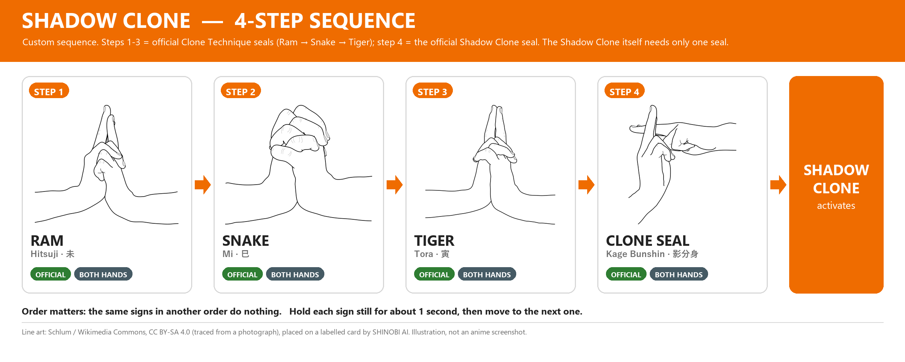
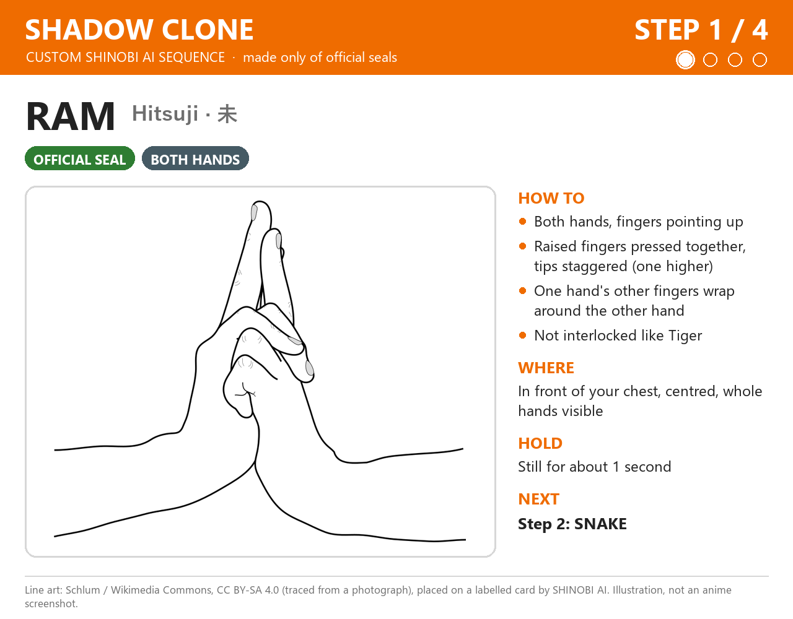
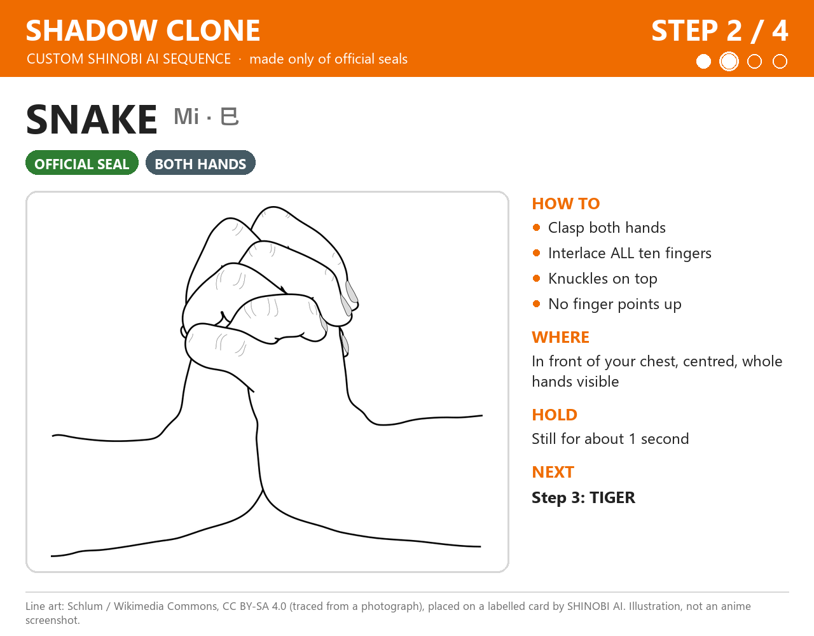
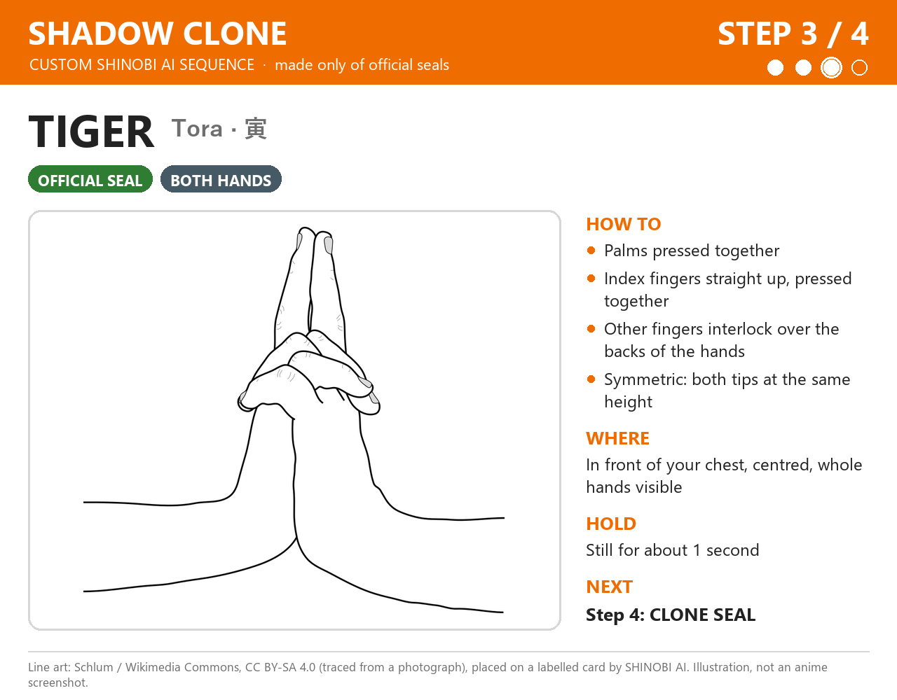
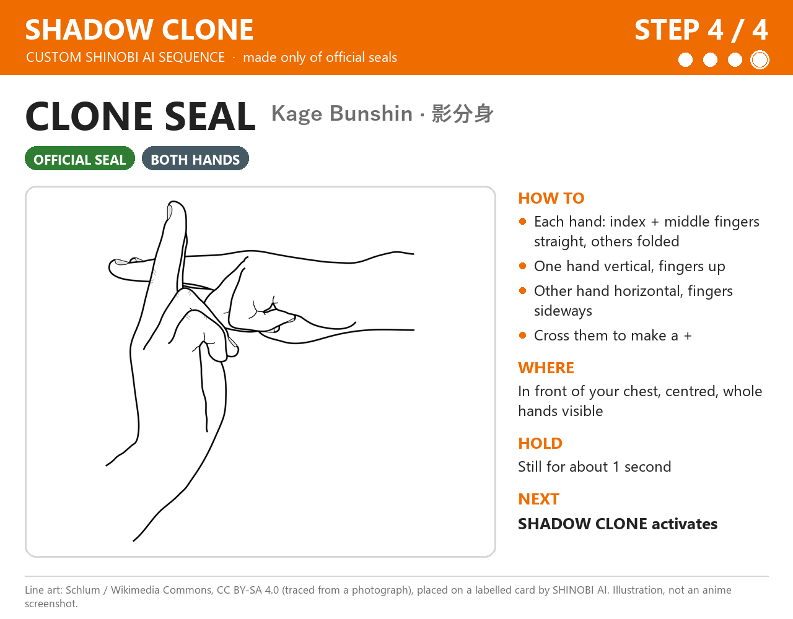

# Shadow Clone — 影分身の術 (Kage Bunshin no Jutsu)

[⬅ كل الـ jutsu](../README.md)

**الحالة: مخصص (Custom) لـ SHINOBI AI.** التسلسل ده **مش رسمي**. إحنا اللي عملناه، بس **من seals رسمية بس**.

- **رسمياً الـ jutsu ده seal واحد بس.** [Narutopedia](https://naruto.fandom.com/wiki/Shadow_Clone_Technique) بيقول: "Clone seal or Tiger or Horse" (مانجا فصل 167، صفحة 11). أول ظهور: مانجا فصل 1، أنمي حلقة 1.
- **الـ Clone seal:** السبابة والوسطى من الإيدين الاتنين متقاطعين ([Hand Seal](https://naruto.fandom.com/wiki/Hand_Seal)، مانجا فصل 1، صفحة 49).
- **Steps 1-3 (Ram → Snake → Tiger):** دول الـ seals الرسمية بتاعة **Clone Technique** العادي (分身の術، Bunshin no Jutsu)، بنفس ترتيبهم ([Narutopedia](https://naruto.fandom.com/wiki/Clone_Technique)، وموجودين كمان في [jutsu.csv](https://github.com/Kazuhito00/NARUTO-HandSignDetection/blob/main/setting/jutsu.csv)).
- **Step 4 (Clone seal):** الـ seal الرسمي بتاع Shadow Clone.
- **تجميعة الـ 4 خطوات دي بتاعتنا**، عشان نوصل لـ 4 خطوات زي باقي الـ jutsu. **مش تسلسل رسمي من Naruto.**

> الصور هنا **رسومات توضيحية (illustrations)** معمولة من رسومات خطية على Wikimedia Commons، والرسومات دي اتعملت من صور فوتوغرافية. **مش screenshots من الأنمي.**

---

## نظرة سريعة



**Step 1 (Ram) → Step 2 (Snake) → Step 3 (Tiger) → Step 4 (Clone seal) → Jutsu Activation**

**أهم حاجة في التسلسل ده:** Ram (Step 1) و Tiger (Step 3) **شبه بعض جداً**. لازم نعمل الفرق بينهم واضح (شوف الشرح تحت).

---

## قبل ما نبدأ: الكاميرا

| | |
|---|---|
| المسافة | نقعد على بعد حوالي **50–70 سم** من اللابتوب |
| مكان الإيدين | **قدام الصدر**، في **نص الصورة** |
| الإيدين | يبانوا **كاملين** في الصورة، من غير صوابع طالعة برّه |
| النور | يبقى **من قدام**. **مانقعدش والشباك ورانا**، لأن النور اللي ورا بيخلي الإيد غامقة والصوابع مش باينة |
| الإيدين في الحركات دي | كل الحركات الأربعة **بالإيدين الاتنين** |
| نفس الشكل كل مرة | نختار مرة واحدة أنهي إيد قدام في Ram، وأنهي إيد بتقف في Clone seal، **ومانغيّرش**. الموديل هيتعلم اللي هنسجّله |

الرسومات ممكن تكون متصورة من زاوية مختلفة عن زاوية الكاميرا. المهم **شكل الصوابع**. نوجّه الإيدين ناحية الكاميرا بحيث الصوابع تبان.

---

## Step 1 — Ram (Hitsuji · 未)



- **الإيدين:** الاتنين.
- **الصوابع:** الصوابع واقفة لفوق زي Tiger، بس الإيدين **فوق بعض** (إيد قدام التانية)، **مش متشابكين بالتساوي**. الصوابع الواقفة **لازقة في بعض**، وطولهم **مش واحد**: طرف صباع أعلى من التاني. باقي صوابع إيد **بتلف حوالين الإيد التانية**.
- **الاتجاه:** الصوابع الواقفة بتشاور **للسقف**.
- **المكان:** قدام الصدر، في نص الصورة.
- **المدة:** نثبّت الحركة حوالي **ثانية** (قيمة مخططة).

**أخطاء شائعة**
- نعملها متماثلة زي Tiger بالظبط. **ده أكبر خطأ**، لأن Ram و Tiger شبه بعض جداً، وفي التسلسل ده Ram هي Step 1 و Tiger هي Step 3.
- الصوابع الواقفة متباعدة بدل ما تكون لازقة.

**الانتقال لـ Step 2 (Snake):** ننزّل الصوابع الواقفة، ونشبّك **كل** الصوابع في بعض.

---

## Step 2 — Snake (Mi · 巳)



- **الإيدين:** الاتنين.
- **الصوابع:** نشبّك **كل** الصوابع في بعض، زي ما بنمسك إيدنا في إيدنا بقوة. **مافيش ولا صباع واقف لفوق.**
- **الاتجاه:** الإيدين ماسكين بعض، و**المفاصل (knuckles) فوق**.
- **المكان:** قدام الصدر.
- **المدة:** حوالي **ثانية** (مخططة).

**أخطاء شائعة**
- صباع واقف لفوق. كده الحركة بتقرّب من Tiger.
- الكفين لازقين في بعض من غير ما الصوابع تتشبّك. ده شبه التصفيق، مش Snake.

**الانتقال لـ Step 3 (Tiger):** من التشبيك، نلزّق الكفين في بعض، ونرفع السبابتين **لفوق** لازقين في بعض. الإيدين يبقوا **متماثلين**، مش إيد قدام التانية زي Ram.

---

## Step 3 — Tiger (Tora · 寅)



- **الإيدين:** الاتنين.
- **الصوابع:** **الكفين لازقين في بعض**. **السبابتين** واقفين **مستقيم لفوق** ولازقين في بعض. باقي الصوابع **متشابكة فوق ظهر الإيدين**. فيه مراجع بترفع **السبابة والوسطى** مع بعض. إحنا بنمشي على الرسمة، ونفضل على نفس الشكل كل مرة.
- **الاتجاه:** الصوابع الواقفة بتشاور **للسقف**. الإيدين **متماثلين** (نفس الشكل بالظبط).
- **المكان:** قدام الصدر، مش قدام الوش.
- **المدة:** حوالي **ثانية** (مخططة).

**أخطاء شائعة**
- الصوابع الواقفة مايلة أو مثنية.
- الخلط مع Ram: في **Tiger** الإيدين متشابكين **بالتساوي** والصوابع الواقفة **نفس الطول**. في **Ram** إيد **قدام** التانية والصوابع الواقفة **مش نفس الطول**.
- الخلط مع Horse: لو السبابتين بيلمسوا من الطرف بس وعاملين مثلث، تبقى دي Horse مش Tiger.

**الانتقال لـ Step 4 (Clone seal):** نفك الإيدين. في كل إيد نخلي **السبابة والوسطى** مفرودين ونقفل الباقي. إيد **تقف** (الصباعين لفوق)، والتانية **بالعرض** وتتحط عليها، فيعملوا علامة **+**.

---

## Step 4 — Clone seal (Kage Bunshin · 影分身)



- **الإيدين:** الاتنين.
- **الصوابع:** في كل إيد: **السبابة والوسطى مفرودين ولازقين في بعض**، والبنصر والخنصر مثنيين، والإبهام ماسكهم.
- **الاتجاه:** إيد **واقفة** (الصباعين بيشاوروا لفوق)، والتانية **بالعرض** (الصباعين بيشاوروا لجنب). نحط الصباعين اللي بالعرض على اللي واقفين، فيعملوا علامة **+** زي الرسمة.
- **المكان:** قدام الصدر، العلامة في نص الصورة، والإيدين الاتنين باينين كاملين.
- **المدة:** حوالي **ثانية** (مخططة).

**أخطاء شائعة**
- البنصر والخنصر مفتوحين بدل ما يكونوا مقفولين.
- السبابة والوسطى متباعدين عن بعض.
- الإيد اللي بالعرض مغطية الإيد الواقفة خالص.
- العلامة قدام الوش بدل الصدر.

**بعد Step 4:** نثبّت العلامة **+** لحد ما الـ jutsu يشتغل.

---

## خطة التمرين

1. **كل حركة لوحدها ببطء:** نبص على صورة الخطوة، ونعمل الحركة، ونثبّتها **3 ثواني**. نعمل ده للأربع حركات. ونركّز في الفرق بين Ram و Tiger.
2. **أسرع شوية:** نفس الكلام، بس كل حركة **ثانية واحدة**.
3. **التسلسل كله:** Ram → Snake → Tiger → Clone seal ورا بعض، في **أقل من حوالي 10 ثواني**.
4. **قدام الكاميرا:** نشغّل البرنامج ونشوف نقط الإيد:

   ```powershell
   .venv\Scripts\python.exe -m shinobi.main
   ```

   - لو النقط مش ظاهرة، ندوس `L`.
   - البرنامج **لسه مش بيتعرف** على الـ seals دي. النقط بس بتورينا الكاميرا شايفة إيدينا ولا لأ. ولما الصوابع تبقى متشابكة، طبيعي النقط تتلخبط شوية.
   - **قبلها نقفل أداة التسجيل** (`Q`) لو كانت مفتوحة، لأن الكاميرا مش بتشتغل مع برنامجين في نفس الوقت.

---

## قواعد التوقيت (مخططة، **لسه مش متنفذة**)

| القاعدة | القيمة المخططة |
|---|---|
| نثبّت كل حركة لحد ما تتحسب | حوالي **ثانية** |
| الحركة اللي بعدها لازم تبدأ في خلال | حوالي **3 ثواني**، وإلا التقدّم يرجع للصفر |
| لو ثبّتنا حركة غلط (مش الخطوة الجاية) | التقدّم في الـ jutsu ده يرجع للصفر |
| الحركات اللي في النص وإحنا بنغيّر شكل الإيد | مش بتتحسب، لأنها مش ثابتة |
| بعد ما أي jutsu يشتغل | **كل** التقدّم في **كل** الـ jutsu يتصفّر، وفيه **cooldown** قبل ما يشتغل تاني |

**مثال:** Shadow Clone بيخلص بـ Clone seal، و Rasengan بيبدأ بـ Clone seal. بعد ما Shadow Clone يشتغل كل حاجة بتتصفّر، فالـ Clone seal اللي في آخر Shadow Clone **مش هيبدأ** Rasengan. عشان نعمل Rasengan بعدها، نستنى الـ cooldown ونبدأ من Clone seal من الأول.

الأرقام دي لسه هتتظبط وتتجرب لما نبني جزء التعرّف على التسلسل.

---

## المصادر

- [Narutopedia: Shadow Clone Technique](https://naruto.fandom.com/wiki/Shadow_Clone_Technique): الـ seal الرسمي: "Clone seal or Tiger or Horse" (مانجا فصل 167، صفحة 11). أول ظهور: مانجا فصل 1، أنمي حلقة 1.
- [Narutopedia: Clone Technique](https://naruto.fandom.com/wiki/Clone_Technique): الـ seals: Ram, Snake, Tiger. أول ظهور: مانجا فصل 1، أنمي حلقة 1.
- [Narutopedia: Hand Seal](https://naruto.fandom.com/wiki/Hand_Seal): وصف الـ Clone seal: السبابة والوسطى من الإيدين متقاطعين (مانجا فصل 1، صفحة 49).
- [NARUTO-HandSignDetection: jutsu.csv](https://github.com/Kazuhito00/NARUTO-HandSignDetection/blob/main/setting/jutsu.csv): Clone Jutsu = 未 巳 寅 (Ram, Snake, Tiger).

إحنا ماشفناش الفصول والحلقات دي بنفسنا. اعتمدنا على المراجع اللي فوق.

---

## حقوق الصور

| الخطوة | الرسمة الأصلية |
|---|---|
| Step 1: Ram | [Mudra-Naruto-Chevre.svg](https://commons.wikimedia.org/wiki/File:Mudra-Naruto-Chevre.svg) ("Goat") |
| Step 2: Snake | [Mudra-Naruto-Serpent.svg](https://commons.wikimedia.org/wiki/File:Mudra-Naruto-Serpent.svg) |
| Step 3: Tiger | [Mudra-Naruto-Tigre.svg](https://commons.wikimedia.org/wiki/File:Mudra-Naruto-Tigre.svg) |
| Step 4: Clone seal | [Mudra-Naruto-KageBunshin.svg](https://commons.wikimedia.org/wiki/File:Mudra-Naruto-KageBunshin.svg) |

الرسومات من رسم **Schlum** على Wikimedia Commons (معمولة من صور فوتوغرافية)، بترخيص [CC BY-SA 4.0](https://creativecommons.org/licenses/by-sa/4.0/). إحنا قصّيناها وحطيناها على كروت فيها أرقام وأسماء وشرح، فصور الخطوات وصورة التسلسل برضه **CC BY-SA 4.0**.
