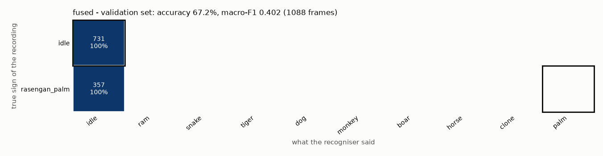
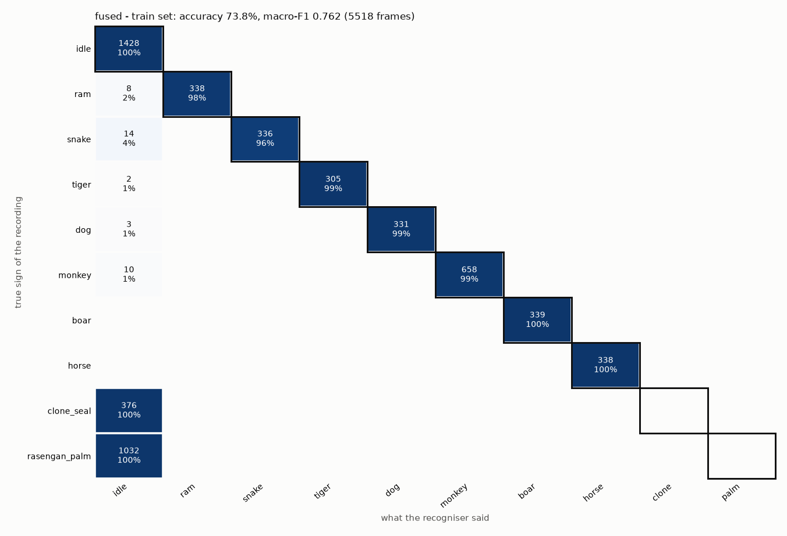

# SHINOBI AI - evaluation report (2026-11-01T00:30:38)

**AI evaluation 2026-11-01 (run B: fused WITHOUT the landmark model = the YOLOX path of the app)**

> **NOT A FINAL RESULT.** No test recordings were evaluated in this run, so none of the numbers below is the honest test result. See the warnings at the end.

> Fused here = YOLOX + hands only; clone_seal and rasengan_palm cannot be named. This is the closest honest proxy for the app's seal decisions on the seal recordings, which the landmark model was trained on.

## 1. What was measured

- **validation** (3 recordings): VALIDATION set: used to choose the landmark model and to tune thresholds. Useful, but NOT the final result.
  - me_night_20261030_222524, me_night_20261030_222754, me_day_20261030_175251
- **train** (16 recordings): TRAIN set: the landmark model learned from these (its numbers are skipped here). YOLOX never saw any of our recordings, so YOLOX and fused-without-landmark-model numbers are still on unseen data, but this is NOT the agreed test set.
  - me_night_20261030_221934, me_night_20261030_222121, me_night_20261030_222258, me_night_20261030_222645, me_night_20261030_220443, me_night_20261030_220610, me_night_20261030_220235, me_night_20261030_215059, me_night_20261030_215447, me_night_20261030_215808, me_night_20261030_220743, me_night_20261030_220040, me_night_20261030_214750, me_day_20261030_174647, me_day_20261030_174917, me_day_20261030_175113

- Landmark model: `None` - **not used**: switched off (--model none)
- YOLOX: `yolox_nano.onnx`, pretrained elsewhere, never trained on our recordings - used.
- Fused = what the app decides: YOLOX + hands only (no landmark model), so clone_seal and rasengan_palm can never be recognised in this run.
- Frames: the first 0.5 s of every single-sign session are not scored (the countdown is not saved; this skips fusion's start-up, see docs/14_evaluation.md). The replay itself starts at 0 s.
- Replay of YOLOX like the app: at most 10 runs per second on the newest saved video frame, each result usable 0.06 s after its frame. The saved video has ~10 frames per second, so the replay ran YOLOX 9.17 times per second (median).
- Thresholds (shinobi/config.py): SEAL_MIN_SCORE 0.7, SEAL_NO_HAND_SCORE 0.85, SEAL_CONFIRM 2, LANDMARK_MIN_PROB 0.6, CONF_ON 0.75, HOLD_SECONDS 0.3.

## 2. Results at a glance (frame level)

| set | recogniser | recordings | frames | accuracy | macro-F1 | balanced accuracy |
|---|---|---|---|---|---|---|
| validation | fused | 3 | 1088 | 67.2% | 0.402 | 50.0% |
| train | fused | 16 | 5518 | 73.8% | 0.762 | 79.1% |

accuracy = share of frames named correctly. macro-F1 / balanced accuracy give every sign the same weight, so a sign the recogniser never gets right pulls them down even if it has few frames.

## 3. Details per set and recogniser

### fused - validation set

_fused, as in the app (SignFusion replayed in time: hands + classifier + YOLOX at SEAL_RATE_HZ)_

From 3 recordings: me_day_20261030_175251, me_night_20261030_222524, me_night_20261030_222754

| sign | precision | recall | F1 | frames (true) | frames (said) |
|---|---|---|---|---|---|
| idle | 67.2% | 100.0% | 0.804 | 731 | 1088 |
| rasengan_palm | - | 0.0% | 0.000 | 357 | 0 |

```
true / said       idle    ram  snake  tiger    dog monkey   boar  horse  clone   palm
idle               731      0      0      0      0      0      0      0      0      0
rasengan_palm      357      0      0      0      0      0      0      0      0      0
```



Time per frame: median 0.04 ms, p90 0.07 ms (measured while other programs shared the CPU: not a final speed).

### fused - train set

_fused, as in the app (SignFusion replayed in time: hands + classifier + YOLOX at SEAL_RATE_HZ)_

From 16 recordings: me_day_20261030_174647, me_day_20261030_174917, me_day_20261030_175113, me_night_20261030_214750, me_night_20261030_215059, me_night_20261030_215447, me_night_20261030_215808, me_night_20261030_220040, me_night_20261030_220235, me_night_20261030_220443, me_night_20261030_220610, me_night_20261030_220743, me_night_20261030_221934, me_night_20261030_222121, me_night_20261030_222258, me_night_20261030_222645

| sign | precision | recall | F1 | frames (true) | frames (said) |
|---|---|---|---|---|---|
| idle | 49.7% | 100.0% | 0.664 | 1428 | 2873 |
| ram | 100.0% | 97.7% | 0.988 | 346 | 338 |
| snake | 100.0% | 96.0% | 0.980 | 350 | 336 |
| tiger | 100.0% | 99.3% | 0.997 | 307 | 305 |
| dog | 100.0% | 99.1% | 0.995 | 334 | 331 |
| monkey | 100.0% | 98.5% | 0.992 | 668 | 658 |
| boar | 100.0% | 100.0% | 1.000 | 339 | 339 |
| horse | 100.0% | 100.0% | 1.000 | 338 | 338 |
| clone_seal | - | 0.0% | 0.000 | 376 | 0 |
| rasengan_palm | - | 0.0% | 0.000 | 1032 | 0 |

```
true / said       idle    ram  snake  tiger    dog monkey   boar  horse  clone   palm
idle              1428      0      0      0      0      0      0      0      0      0
ram                  8    338      0      0      0      0      0      0      0      0
snake               14      0    336      0      0      0      0      0      0      0
tiger                2      0      0    305      0      0      0      0      0      0
dog                  3      0      0      0    331      0      0      0      0      0
monkey              10      0      0      0      0    658      0      0      0      0
boar                 0      0      0      0      0      0    339      0      0      0
horse                0      0      0      0      0      0      0    338      0      0
clone_seal         376      0      0      0      0      0      0      0      0      0
rasengan_palm     1032      0      0      0      0      0      0      0      0      0
```



Time per frame: median 0.07 ms, p90 0.15 ms (measured while other programs shared the CPU: not a final speed).

## 4. Every recording

| set | recording | sign | hands found | landmarks | yolox | fused | signs confirmed by the controller | jutsu fired |
|---|---|---|---|---|---|---|---|---|
| validation | me_night_20261030_222524 | idle | 100.0% | - | - | 100.0% | - | none |
| validation | me_night_20261030_222754 | idle | 100.0% | - | - | 100.0% | - | none |
| validation | me_day_20261030_175251 | rasengan_palm | 100.0% | - | - | 0.0% | - | none |
| train | me_night_20261030_221934 | idle | 25.2% | - | - | 100.0% | - | none |
| train | me_night_20261030_222121 | idle | 94.4% | - | - | 100.0% | - | none |
| train | me_night_20261030_222258 | idle | 97.2% | - | - | 100.0% | - | none |
| train | me_night_20261030_222645 | idle | 98.4% | - | - | 100.0% | - | none |
| train | me_night_20261030_220443 | ram | 100.0% | - | - | 97.7% | ram, ram, ram | none |
| train | me_night_20261030_220610 | snake | 100.0% | - | - | 96.0% | snake, snake, snake, snake | none |
| train | me_night_20261030_220235 | tiger | 100.0% | - | - | 99.4% | tiger, tiger | none |
| train | me_night_20261030_215059 | dog | 100.0% | - | - | 99.1% | dog | none |
| train | me_night_20261030_215447 | monkey | 35.8% | - | - | 97.1% | monkey | none |
| train | me_night_20261030_215808 | monkey | 93.3% | - | - | 100.0% | monkey | none |
| train | me_night_20261030_220743 | boar | 100.0% | - | - | 100.0% | boar | none |
| train | me_night_20261030_220040 | horse | 100.0% | - | - | 100.0% | horse | none |
| train | me_night_20261030_214750 | clone_seal | 100.0% | - | - | 0.0% | - | none |
| train | me_day_20261030_174647 | rasengan_palm | 100.0% | - | - | 0.0% | - | none |
| train | me_day_20261030_174917 | rasengan_palm | 100.0% | - | - | 0.0% | - | none |
| train | me_day_20261030_175113 | rasengan_palm | 100.0% | - | - | 0.0% | - | none |

"signs confirmed" = what the GestureStabilizer accepted (held long enough); holding one sign should confirm exactly that sign once.

## 5. Jutsu (sequence level)

**Single-sign sessions replayed through the controller:** 19 sessions, 6.34 minutes, **0 jutsu fired** (should be 0: one held sign can never complete a 4-sign jutsu).

**Guided sequence takes:** none recorded yet (data/sequences is empty). Record them with `record_sequences.py`, run `python evaluate.py splits`, then evaluate again.

## 6. Warnings and caveats

- No landmark model: switched off (--model none). Landmark numbers are missing and fused = YOLOX + hands only (clone_seal and rasengan_palm cannot be recognised).
- Signs without any test recording yet: idle, ram, snake, tiger, dog, monkey, boar, horse, clone_seal, rasengan_palm. They have no honest test number.
- Only one recording evaluated for: boar, clone_seal, dog, horse, ram, snake, tiger. One recording = one person, one day, one light: treat those numbers as a smoke test.
- All evaluated recordings come from day 2026-10-30, night 2026-10-30: nothing here says how the app does in other light or on other days.
- YOLOX sees the saved 480p reference video (mp4), not the live 720p camera frame: pixels differ a little from the app's.
- Hands come from the landmarks saved while recording (MediaPipe on the live 720p frame), as the app would have them; MediaPipe itself is not re-run.

## 7. How to read this report

- **Precision** of a sign: when the recogniser said it, how often was it right? Low = effects fire by mistake.
- **Recall** of a sign: of the frames that really were that sign, how many were found? Low = you do the sign and nothing happens.
- **Confusion matrix**: rows = the sign that was really recorded, columns = what was said. The outlined cell is the right answer; everything else in the row is a mistake.
- **Frame level** numbers are strict: a single wrong frame counts. The app smooths over frames, which is why section 5 (what the user actually sees) matters too.
- Numbers from few recordings move a lot: one recording per sign is a smoke test, not a measurement.
- More: docs/14_evaluation.md.
