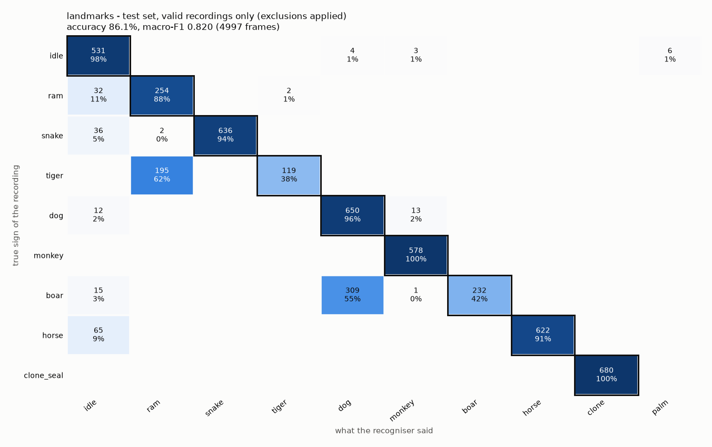
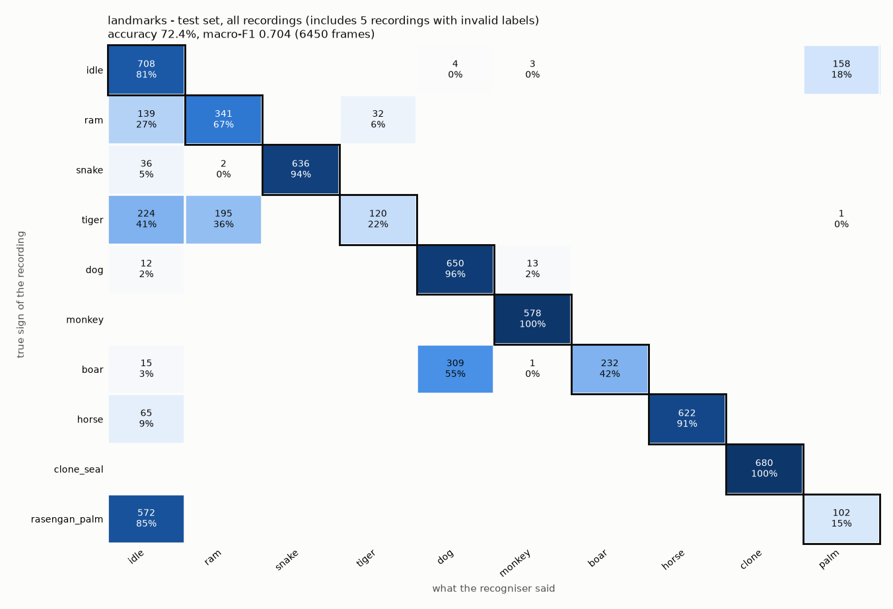
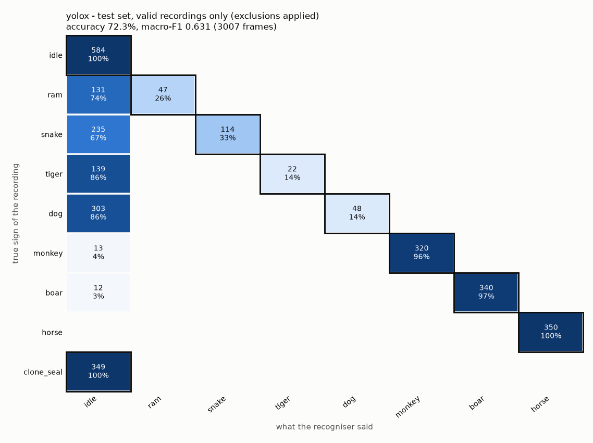
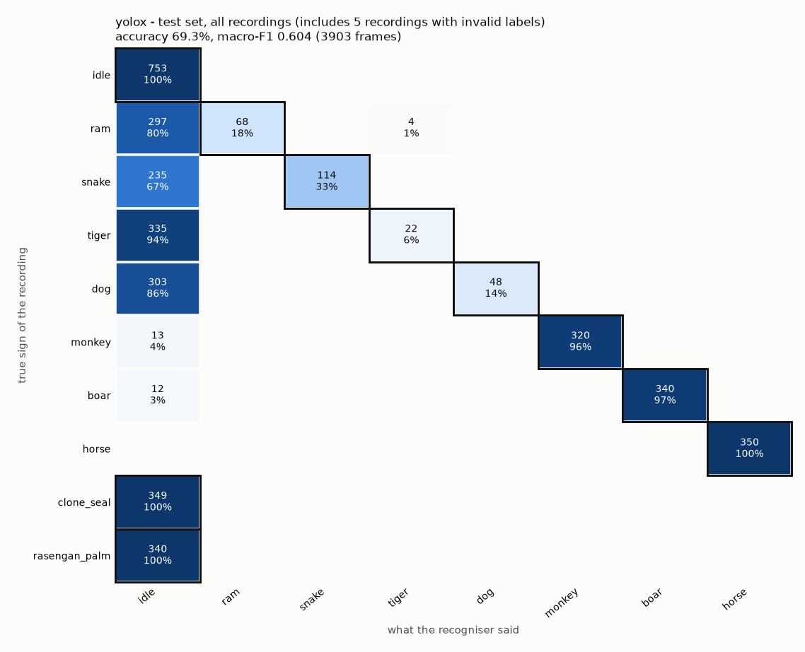
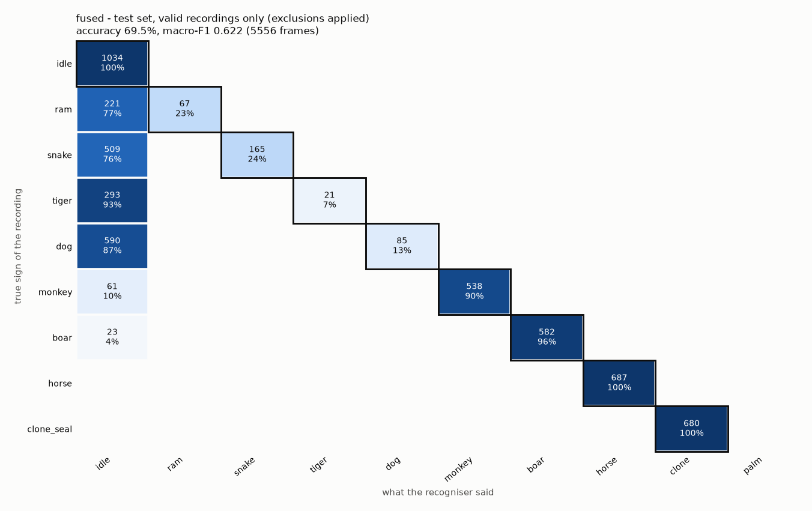
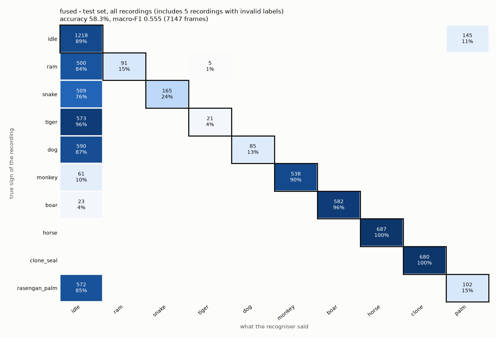
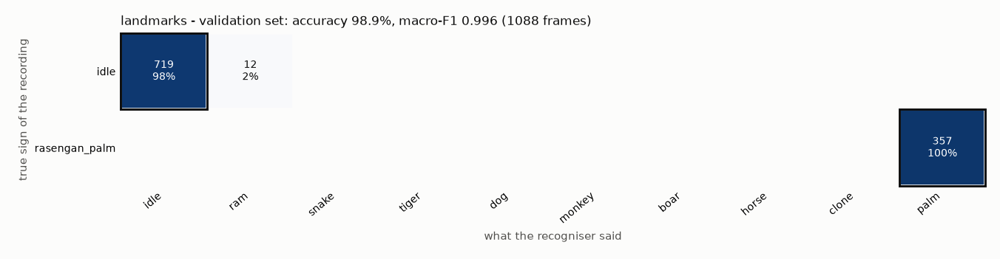
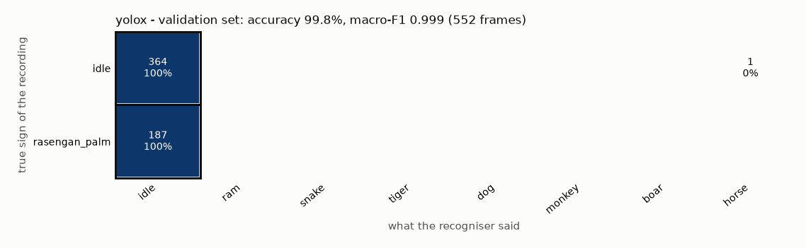
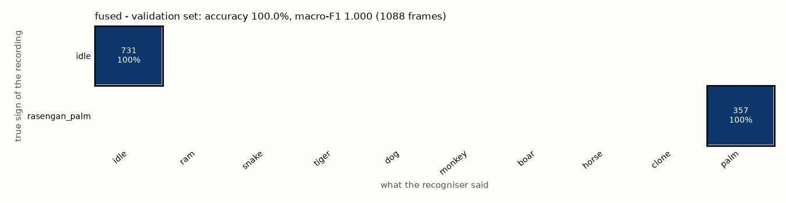

# SHINOBI AI - evaluation report (2026-11-01T22:56:54)

**Model experiment 2026-11-01: random_forest (models/experiments/random_forest/gesture_model.joblib) - NOT deployed**

## Excluded from the scores: 5 recording(s) with invalid labels

Listed in `C:\Users\user\Desktop\SHINOBI-AI\data\evaluation_exclusions.json`. They were **not deleted and not moved**: each keeps its set in splits.json and is still evaluated on its own (section 4, marked EXCLUDED). Every aggregate they would be part of is given twice: **valid recordings only (exclusions applied)** is the result; **all recordings** also counts these invalid labels and is shown only for comparison.

| set | recording | label | reason | evidence | decided |
|---|---|---|---|---|---|
| test | me_day_20261101_141753 | idle | invalid label: meant to be an OK sign (idle), but shows open palms with spread fingers (one, then two), i.e. the rasengan_palm gesture. | reports/2026-11-01_diagnosis/evidence/idle_ok_close.png | 2026-11-01 by user |
| test | me_day_20261101_140631 | ram | invalid label (partial): Ram is performed only in the first \~9 s; then no hands (10-14 s) and a hand on the mouth (14-20 s). Recorded by the old recorder version that ran ahead of the user. | reports/2026-11-01_diagnosis/evidence/first_ram_dense.png | 2026-11-01 by user |
| test | me_day_20261101_140826 | tiger | invalid label: no Tiger gesture at any time (phone in hand, touching the face). Recorded by the old recorder version that ran ahead of the user. | reports/2026-11-01_diagnosis/evidence/first_tiger_dense.png | 2026-11-01 by user |
| test | me_day_20261101_141718 | rasengan_palm | invalid label for the agreed gesture: two open palms in most of the recording (two hands seen in 83% of frames); the agreed rasengan_palm is ONE open palm toward the camera, fingers spread (user decision 2026-11-01). | reports/2026-11-01_diagnosis/evidence/sheet_rasengan_palm.png | 2026-11-01 by user |
| test | me_day_20261101_142407 | rasengan_palm | invalid label for the agreed gesture: two open palms in most of the recording (two hands seen in 83% of frames); the agreed rasengan_palm is ONE open palm toward the camera, fingers spread (user decision 2026-11-01). | reports/2026-11-01_diagnosis/evidence/sheet_rasengan_palm.png | 2026-11-01 by user |

## 1. What was measured

- **test** (22 recordings, 5 of them excluded from the scores): TEST set: the headline. No model learned from these recordings and nothing was tuned on them.
  - me_day_20261101_140600, me_day_20261101_141753 (EXCLUDED), me_day_20261101_141901, me_day_20261101_142440, me_day_20261101_140631 (EXCLUDED), me_day_20261101_141955, me_day_20261101_141409, me_day_20261101_142024, me_day_20261101_140826 (EXCLUDED), me_day_20261101_142054, me_day_20261101_141440, me_day_20261101_142126, me_day_20261101_141518, me_day_20261101_142204, me_day_20261101_141550, me_day_20261101_142239, me_day_20261101_141623, me_day_20261101_142311, me_day_20261101_141650, me_day_20261101_142339, me_day_20261101_141718 (EXCLUDED), me_day_20261101_142407 (EXCLUDED)
- **validation** (3 recordings): VALIDATION set: used to choose the landmark model and to tune thresholds. Useful, but NOT the final result.
  - me_night_20261030_222524, me_night_20261030_222754, me_day_20261030_175251

- Landmark model: `models\experiments\random_forest\gesture_model.joblib` - used (random_forest, trained on 43 train recordings, created 2026-11-01T22:50:03).
- YOLOX: `yolox_nano.onnx`, pretrained elsewhere, never trained on our recordings - used.
- Fused = what the app decides: YOLOX + hands + landmark classifier.
- Frames: the first 0.5 s of every single-sign session are not scored (the countdown is not saved; this skips fusion's start-up, see docs/14_evaluation.md). The replay itself starts at 0 s.
- Replay of YOLOX like the app: at most 10 runs per second on the newest saved video frame, each result usable 0.06 s after its frame. The saved video has ~10 frames per second, so the replay ran YOLOX 8.93 times per second (median).
- Thresholds (shinobi/config.py): SEAL_MIN_SCORE 0.7, SEAL_NO_HAND_SCORE 0.85, SEAL_CONFIRM 2, LANDMARK_MIN_PROB 0.6, CONF_ON 0.75, HOLD_SECONDS 0.3.

## 2. Results at a glance (frame level)

**Valid recordings only (exclusions applied)** - the result:

| set | recogniser | recordings | frames | accuracy | macro-F1 | balanced accuracy |
|---|---|---|---|---|---|---|
| test | landmarks | 16 | 4997 | 86.1% | 0.820 | 83.0% |
| test | yolox | 17 | 3007 | 72.3% | 0.631 | 59.9% |
| test | fused | 17 | 5556 | 69.5% | 0.622 | 61.4% |
| validation | landmarks | 3 | 1088 | 98.9% | 0.996 | 99.2% |
| validation | yolox | 3 | 552 | 99.8% | 0.999 | 99.8% |
| validation | fused | 3 | 1088 | 100.0% | 1.000 | 100.0% |

**All recordings (includes 5 recordings with invalid labels)** - contaminated by invalid labels, for comparison only:

| set | recogniser | recordings | frames | accuracy | macro-F1 | balanced accuracy |
|---|---|---|---|---|---|---|
| test | landmarks | 21 | 6450 | 72.4% | 0.704 | 70.8% |
| test | yolox | 22 | 3903 | 69.3% | 0.604 | 58.0% |
| test | fused | 22 | 7147 | 58.3% | 0.555 | 54.6% |

accuracy = share of frames named correctly. macro-F1 / balanced accuracy give every sign the same weight, so a sign the recogniser never gets right pulls them down even if it has few frames.

## 3. Details per set and recogniser

### landmarks - test set

_landmark classifier alone (frames where MediaPipe found a hand)_

#### Valid recordings only (exclusions applied)

From 16 recordings: me_day_20261101_141409, me_day_20261101_141440, me_day_20261101_141518, me_day_20261101_141550, me_day_20261101_141623, me_day_20261101_141650, me_day_20261101_141901, me_day_20261101_141955, me_day_20261101_142024, me_day_20261101_142054, me_day_20261101_142126, me_day_20261101_142204, me_day_20261101_142239, me_day_20261101_142311, me_day_20261101_142339, me_day_20261101_142440

| sign | precision | recall | F1 | frames (true) | frames (said) |
|---|---|---|---|---|---|
| idle | 76.8% | 97.6% | 0.860 | 544 | 691 |
| ram | 56.3% | 88.2% | 0.687 | 288 | 451 |
| snake | 100.0% | 94.4% | 0.971 | 674 | 636 |
| tiger | 98.3% | 37.9% | 0.547 | 314 | 121 |
| dog | 67.5% | 96.3% | 0.794 | 675 | 963 |
| monkey | 97.1% | 100.0% | 0.986 | 578 | 595 |
| boar | 100.0% | 41.7% | 0.588 | 557 | 232 |
| horse | 100.0% | 90.5% | 0.950 | 687 | 622 |
| clone_seal | 100.0% | 100.0% | 1.000 | 680 | 680 |
| rasengan_palm | 0.0% | - | - | 0 | 6 |

```
true / said       idle    ram  snake  tiger    dog monkey   boar  horse  clone   palm
idle               531      0      0      0      4      3      0      0      0      6
ram                 32    254      0      2      0      0      0      0      0      0
snake               36      2    636      0      0      0      0      0      0      0
tiger                0    195      0    119      0      0      0      0      0      0
dog                 12      0      0      0    650     13      0      0      0      0
monkey               0      0      0      0      0    578      0      0      0      0
boar                15      0      0      0    309      1    232      0      0      0
horse               65      0      0      0      0      0      0    622      0      0
clone_seal           0      0      0      0      0      0      0      0    680      0
```



Time per frame: median 0.84 ms, p90 1.0 ms (measured while other programs shared the CPU: not a final speed).

#### All recordings (includes 5 recordings with invalid labels)

_Contaminated by invalid labels: for comparison only, not the result._

From 21 recordings: me_day_20261101_140631 (EXCLUDED), me_day_20261101_140826 (EXCLUDED), me_day_20261101_141409, me_day_20261101_141440, me_day_20261101_141518, me_day_20261101_141550, me_day_20261101_141623, me_day_20261101_141650, me_day_20261101_141718 (EXCLUDED), me_day_20261101_141753 (EXCLUDED), me_day_20261101_141901, me_day_20261101_141955, me_day_20261101_142024, me_day_20261101_142054, me_day_20261101_142126, me_day_20261101_142204, me_day_20261101_142239, me_day_20261101_142311, me_day_20261101_142339, me_day_20261101_142407 (EXCLUDED), me_day_20261101_142440

| sign | precision | recall | F1 | frames (true) | frames (said) |
|---|---|---|---|---|---|
| idle | 40.0% | 81.1% | 0.536 | 873 | 1771 |
| ram | 63.4% | 66.6% | 0.650 | 512 | 538 |
| snake | 100.0% | 94.4% | 0.971 | 674 | 636 |
| tiger | 78.9% | 22.2% | 0.347 | 540 | 152 |
| dog | 67.5% | 96.3% | 0.794 | 675 | 963 |
| monkey | 97.1% | 100.0% | 0.986 | 578 | 595 |
| boar | 100.0% | 41.7% | 0.588 | 557 | 232 |
| horse | 100.0% | 90.5% | 0.950 | 687 | 622 |
| clone_seal | 100.0% | 100.0% | 1.000 | 680 | 680 |
| rasengan_palm | 39.1% | 15.1% | 0.218 | 674 | 261 |

```
true / said       idle    ram  snake  tiger    dog monkey   boar  horse  clone   palm
idle               708      0      0      0      4      3      0      0      0    158
ram                139    341      0     32      0      0      0      0      0      0
snake               36      2    636      0      0      0      0      0      0      0
tiger              224    195      0    120      0      0      0      0      0      1
dog                 12      0      0      0    650     13      0      0      0      0
monkey               0      0      0      0      0    578      0      0      0      0
boar                15      0      0      0    309      1    232      0      0      0
horse               65      0      0      0      0      0      0    622      0      0
clone_seal           0      0      0      0      0      0      0      0    680      0
rasengan_palm      572      0      0      0      0      0      0      0      0    102
```



### yolox - test set

_YOLOX alone (saved video frames; best seal >= SEAL_MIN_SCORE, no hand check, no 2-in-a-row)_

#### Valid recordings only (exclusions applied)

From 17 recordings: me_day_20261101_140600, me_day_20261101_141409, me_day_20261101_141440, me_day_20261101_141518, me_day_20261101_141550, me_day_20261101_141623, me_day_20261101_141650, me_day_20261101_141901, me_day_20261101_141955, me_day_20261101_142024, me_day_20261101_142054, me_day_20261101_142126, me_day_20261101_142204, me_day_20261101_142239, me_day_20261101_142311, me_day_20261101_142339, me_day_20261101_142440

| sign | precision | recall | F1 | frames (true) | frames (said) |
|---|---|---|---|---|---|
| idle | 52.8% | 100.0% | 0.691 | 933 | 1766 |
| ram | 100.0% | 26.4% | 0.418 | 178 | 47 |
| snake | 100.0% | 32.7% | 0.492 | 349 | 114 |
| tiger | 100.0% | 13.7% | 0.240 | 161 | 22 |
| dog | 100.0% | 13.7% | 0.241 | 351 | 48 |
| monkey | 100.0% | 96.1% | 0.980 | 333 | 320 |
| boar | 100.0% | 96.6% | 0.983 | 352 | 340 |
| horse | 100.0% | 100.0% | 1.000 | 350 | 350 |

```
true / said       idle    ram  snake  tiger    dog monkey   boar  horse
idle               584      0      0      0      0      0      0      0
ram                131     47      0      0      0      0      0      0
snake              235      0    114      0      0      0      0      0
tiger              139      0      0     22      0      0      0      0
dog                303      0      0      0     48      0      0      0
monkey              13      0      0      0      0    320      0      0
boar                12      0      0      0      0      0    340      0
horse                0      0      0      0      0      0      0    350
clone_seal         349      0      0      0      0      0      0      0
```

YOLOX has no class for idle, clone_seal or rasengan_palm: for those recordings the right answer is `idle` (no seal).



Time per YOLOX run: median 31.65 ms, p90 37.76 ms (measured while other programs shared the CPU: not a final speed).

#### All recordings (includes 5 recordings with invalid labels)

_Contaminated by invalid labels: for comparison only, not the result._

From 22 recordings: me_day_20261101_140600, me_day_20261101_140631 (EXCLUDED), me_day_20261101_140826 (EXCLUDED), me_day_20261101_141409, me_day_20261101_141440, me_day_20261101_141518, me_day_20261101_141550, me_day_20261101_141623, me_day_20261101_141650, me_day_20261101_141718 (EXCLUDED), me_day_20261101_141753 (EXCLUDED), me_day_20261101_141901, me_day_20261101_141955, me_day_20261101_142024, me_day_20261101_142054, me_day_20261101_142126, me_day_20261101_142204, me_day_20261101_142239, me_day_20261101_142311, me_day_20261101_142339, me_day_20261101_142407 (EXCLUDED), me_day_20261101_142440

| sign | precision | recall | F1 | frames (true) | frames (said) |
|---|---|---|---|---|---|
| idle | 54.7% | 100.0% | 0.707 | 1442 | 2637 |
| ram | 100.0% | 18.4% | 0.311 | 369 | 68 |
| snake | 100.0% | 32.7% | 0.492 | 349 | 114 |
| tiger | 84.6% | 6.2% | 0.115 | 357 | 26 |
| dog | 100.0% | 13.7% | 0.241 | 351 | 48 |
| monkey | 100.0% | 96.1% | 0.980 | 333 | 320 |
| boar | 100.0% | 96.6% | 0.983 | 352 | 340 |
| horse | 100.0% | 100.0% | 1.000 | 350 | 350 |

```
true / said       idle    ram  snake  tiger    dog monkey   boar  horse
idle               753      0      0      0      0      0      0      0
ram                297     68      0      4      0      0      0      0
snake              235      0    114      0      0      0      0      0
tiger              335      0      0     22      0      0      0      0
dog                303      0      0      0     48      0      0      0
monkey              13      0      0      0      0    320      0      0
boar                12      0      0      0      0      0    340      0
horse                0      0      0      0      0      0      0    350
clone_seal         349      0      0      0      0      0      0      0
rasengan_palm      340      0      0      0      0      0      0      0
```



### fused - test set

_fused, as in the app (SignFusion replayed in time: hands + classifier + YOLOX at SEAL_RATE_HZ)_

#### Valid recordings only (exclusions applied)

From 17 recordings: me_day_20261101_140600, me_day_20261101_141409, me_day_20261101_141440, me_day_20261101_141518, me_day_20261101_141550, me_day_20261101_141623, me_day_20261101_141650, me_day_20261101_141901, me_day_20261101_141955, me_day_20261101_142024, me_day_20261101_142054, me_day_20261101_142126, me_day_20261101_142204, me_day_20261101_142239, me_day_20261101_142311, me_day_20261101_142339, me_day_20261101_142440

| sign | precision | recall | F1 | frames (true) | frames (said) |
|---|---|---|---|---|---|
| idle | 37.9% | 100.0% | 0.549 | 1034 | 2731 |
| ram | 100.0% | 23.3% | 0.377 | 288 | 67 |
| snake | 100.0% | 24.5% | 0.393 | 674 | 165 |
| tiger | 100.0% | 6.7% | 0.125 | 314 | 21 |
| dog | 100.0% | 12.6% | 0.224 | 675 | 85 |
| monkey | 100.0% | 89.8% | 0.946 | 599 | 538 |
| boar | 100.0% | 96.2% | 0.981 | 605 | 582 |
| horse | 100.0% | 100.0% | 1.000 | 687 | 687 |
| clone_seal | 100.0% | 100.0% | 1.000 | 680 | 680 |

```
true / said       idle    ram  snake  tiger    dog monkey   boar  horse  clone   palm
idle              1034      0      0      0      0      0      0      0      0      0
ram                221     67      0      0      0      0      0      0      0      0
snake              509      0    165      0      0      0      0      0      0      0
tiger              293      0      0     21      0      0      0      0      0      0
dog                590      0      0      0     85      0      0      0      0      0
monkey              61      0      0      0      0    538      0      0      0      0
boar                23      0      0      0      0      0    582      0      0      0
horse                0      0      0      0      0      0      0    687      0      0
clone_seal           0      0      0      0      0      0      0      0    680      0
```



Time per frame: median 0.07 ms, p90 0.1 ms (measured while other programs shared the CPU: not a final speed).

#### All recordings (includes 5 recordings with invalid labels)

_Contaminated by invalid labels: for comparison only, not the result._

From 22 recordings: me_day_20261101_140600, me_day_20261101_140631 (EXCLUDED), me_day_20261101_140826 (EXCLUDED), me_day_20261101_141409, me_day_20261101_141440, me_day_20261101_141518, me_day_20261101_141550, me_day_20261101_141623, me_day_20261101_141650, me_day_20261101_141718 (EXCLUDED), me_day_20261101_141753 (EXCLUDED), me_day_20261101_141901, me_day_20261101_141955, me_day_20261101_142024, me_day_20261101_142054, me_day_20261101_142126, me_day_20261101_142204, me_day_20261101_142239, me_day_20261101_142311, me_day_20261101_142339, me_day_20261101_142407 (EXCLUDED), me_day_20261101_142440

| sign | precision | recall | F1 | frames (true) | frames (said) |
|---|---|---|---|---|---|
| idle | 30.1% | 89.4% | 0.450 | 1363 | 4046 |
| ram | 100.0% | 15.3% | 0.265 | 596 | 91 |
| snake | 100.0% | 24.5% | 0.393 | 674 | 165 |
| tiger | 80.8% | 3.5% | 0.068 | 594 | 26 |
| dog | 100.0% | 12.6% | 0.224 | 675 | 85 |
| monkey | 100.0% | 89.8% | 0.946 | 599 | 538 |
| boar | 100.0% | 96.2% | 0.981 | 605 | 582 |
| horse | 100.0% | 100.0% | 1.000 | 687 | 687 |
| clone_seal | 100.0% | 100.0% | 1.000 | 680 | 680 |
| rasengan_palm | 41.3% | 15.1% | 0.221 | 674 | 247 |

```
true / said       idle    ram  snake  tiger    dog monkey   boar  horse  clone   palm
idle              1218      0      0      0      0      0      0      0      0    145
ram                500     91      0      5      0      0      0      0      0      0
snake              509      0    165      0      0      0      0      0      0      0
tiger              573      0      0     21      0      0      0      0      0      0
dog                590      0      0      0     85      0      0      0      0      0
monkey              61      0      0      0      0    538      0      0      0      0
boar                23      0      0      0      0      0    582      0      0      0
horse                0      0      0      0      0      0      0    687      0      0
clone_seal           0      0      0      0      0      0      0      0    680      0
rasengan_palm      572      0      0      0      0      0      0      0      0    102
```



### landmarks - validation set

_landmark classifier alone (frames where MediaPipe found a hand)_

From 3 recordings: me_day_20261030_175251, me_night_20261030_222524, me_night_20261030_222754

| sign | precision | recall | F1 | frames (true) | frames (said) |
|---|---|---|---|---|---|
| idle | 100.0% | 98.4% | 0.992 | 731 | 719 |
| ram | 0.0% | - | - | 0 | 12 |
| rasengan_palm | 100.0% | 100.0% | 1.000 | 357 | 357 |

```
true / said       idle    ram  snake  tiger    dog monkey   boar  horse  clone   palm
idle               719     12      0      0      0      0      0      0      0      0
rasengan_palm        0      0      0      0      0      0      0      0      0    357
```



Time per frame: median 0.86 ms, p90 1.51 ms (measured while other programs shared the CPU: not a final speed).

### yolox - validation set

_YOLOX alone (saved video frames; best seal >= SEAL_MIN_SCORE, no hand check, no 2-in-a-row)_

From 3 recordings: me_day_20261030_175251, me_night_20261030_222524, me_night_20261030_222754

| sign | precision | recall | F1 | frames (true) | frames (said) |
|---|---|---|---|---|---|
| idle | 100.0% | 99.8% | 0.999 | 552 | 551 |
| horse | 0.0% | - | - | 0 | 1 |

```
true / said       idle    ram  snake  tiger    dog monkey   boar  horse
idle               364      0      0      0      0      0      0      1
rasengan_palm      187      0      0      0      0      0      0      0
```

YOLOX has no class for idle, clone_seal or rasengan_palm: for those recordings the right answer is `idle` (no seal).



Time per YOLOX run: median 35.8 ms, p90 45.1 ms (measured while other programs shared the CPU: not a final speed).

### fused - validation set

_fused, as in the app (SignFusion replayed in time: hands + classifier + YOLOX at SEAL_RATE_HZ)_

From 3 recordings: me_day_20261030_175251, me_night_20261030_222524, me_night_20261030_222754

| sign | precision | recall | F1 | frames (true) | frames (said) |
|---|---|---|---|---|---|
| idle | 100.0% | 100.0% | 1.000 | 731 | 731 |
| rasengan_palm | 100.0% | 100.0% | 1.000 | 357 | 357 |

```
true / said       idle    ram  snake  tiger    dog monkey   boar  horse  clone   palm
idle               731      0      0      0      0      0      0      0      0      0
rasengan_palm        0      0      0      0      0      0      0      0      0    357
```



Time per frame: median 0.08 ms, p90 0.11 ms (measured while other programs shared the CPU: not a final speed).

## 4. Every recording

| set | recording | sign | hands found | landmarks | yolox | fused | signs confirmed by the controller | jutsu fired |
|---|---|---|---|---|---|---|---|---|
| test | me_day_20261101_140600 | idle | 0.0% | - | 100.0% | 100.0% | - | none |
| test | me_day_20261101_141753 - **EXCLUDED: invalid label: meant to be an OK sign (idle), but shows open palms with spread fingers (one, then two), i.e. the rasengan_palm gesture.** | idle | 100.0% | 53.8% | 100.0% | 55.9% | rasengan_palm | none |
| test | me_day_20261101_141901 | idle | 77.1% | 97.3% | 100.0% | 100.0% | - | none |
| test | me_day_20261101_142440 | idle | 97.3% | 97.8% | 100.0% | 100.0% | - | none |
| test | me_day_20261101_140631 - **EXCLUDED: invalid label (partial): Ram is performed only in the first \~9 s; then no hands (10-14 s) and a hand on the mouth (14-20 s). Recorded by the old recorder version that ran ahead of the user.** | ram | 72.7% | 38.8% | 11.0% | 7.8% | ram | none |
| test | me_day_20261101_141955 | ram | 100.0% | 88.2% | 26.4% | 23.3% | ram, ram, ram, ram | none |
| test | me_day_20261101_141409 | snake | 100.0% | 88.6% | 16.0% | 6.3% | - | none |
| test | me_day_20261101_142024 | snake | 100.0% | 100.0% | 49.4% | 42.4% | snake, snake, snake, snake, snake, snake, snake | none |
| test | me_day_20261101_140826 - **EXCLUDED: invalid label: no Tiger gesture at any time (phone in hand, touching the face). Recorded by the old recorder version that ran ahead of the user.** | tiger | 80.7% | 0.4% | 0.0% | 0.0% | - | none |
| test | me_day_20261101_142054 | tiger | 100.0% | 37.9% | 13.7% | 6.7% | tiger | none |
| test | me_day_20261101_141440 | dog | 100.0% | 99.4% | 27.3% | 25.1% | dog, dog | none |
| test | me_day_20261101_142126 | dog | 100.0% | 93.2% | 0.0% | 0.0% | - | none |
| test | me_day_20261101_141518 | monkey | 93.7% | 100.0% | 92.3% | 79.7% | monkey, monkey, monkey, monkey, monkey | none |
| test | me_day_20261101_142204 | monkey | 99.3% | 100.0% | 100.0% | 100.0% | monkey | none |
| test | me_day_20261101_141550 | boar | 87.8% | 76.6% | 93.4% | 92.6% | boar, boar | none |
| test | me_day_20261101_142239 | boar | 96.6% | 8.1% | 100.0% | 100.0% | boar | none |
| test | me_day_20261101_141623 | horse | 100.0% | 100.0% | 100.0% | 100.0% | horse | none |
| test | me_day_20261101_142311 | horse | 100.0% | 81.2% | 100.0% | 100.0% | horse | none |
| test | me_day_20261101_141650 | clone_seal | 100.0% | 100.0% | 100.0% | 100.0% | clone_seal | none |
| test | me_day_20261101_142339 | clone_seal | 100.0% | 100.0% | 100.0% | 100.0% | clone_seal | none |
| test | me_day_20261101_141718 - **EXCLUDED: invalid label for the agreed gesture: two open palms in most of the recording (two hands seen in 83% of frames); the agreed rasengan_palm is ONE open palm toward the camera, fingers spread (user decision 2026-11-01).** | rasengan_palm | 100.0% | 15.5% | 100.0% | 15.5% | rasengan_palm | none |
| test | me_day_20261101_142407 - **EXCLUDED: invalid label for the agreed gesture: two open palms in most of the recording (two hands seen in 83% of frames); the agreed rasengan_palm is ONE open palm toward the camera, fingers spread (user decision 2026-11-01).** | rasengan_palm | 100.0% | 14.8% | 100.0% | 14.8% | rasengan_palm | none |
| validation | me_night_20261030_222524 | idle | 100.0% | 96.7% | 99.4% | 100.0% | - | none |
| validation | me_night_20261030_222754 | idle | 100.0% | 100.0% | 100.0% | 100.0% | - | none |
| validation | me_day_20261030_175251 | rasengan_palm | 100.0% | 100.0% | 100.0% | 100.0% | rasengan_palm | none |

"signs confirmed" = what the GestureStabilizer accepted (held long enough); holding one sign should confirm exactly that sign once.

Rows marked EXCLUDED have an invalid label: they are shown for completeness, their frames are counted only in the "all recordings" numbers, never in the valid recordings only (exclusions applied) ones.

## 5. Jutsu (sequence level)

**Single-sign sessions replayed through the controller, valid recordings only (exclusions applied):** 20 sessions, 6.65 minutes, **0 jutsu fired** (should be 0: one held sign can never complete a 4-sign jutsu).

**Single-sign sessions replayed through the controller, all recordings (includes 5 recordings with invalid labels), for comparison only:** 25 sessions, 8.31 minutes, **0 jutsu fired** (should be 0: one held sign can never complete a 4-sign jutsu).

**Guided sequence takes:** none recorded yet (data/sequences is empty). Record them with `record_sequences.py`, run `python evaluate.py splits`, then evaluate again.

## 6. Warnings and caveats

- 1 recording(s) have no set yet and were NOT evaluated: me_day_20261101_140757. Run `python evaluate.py splits`.
- Signs whose only test recordings are excluded (invalid labels): rasengan_palm. They have no valid test number.
- Test recordings that share day + lighting with training data: idle, ram, snake, tiger, dog, monkey, boar, horse, clone_seal, rasengan_palm (optimistic numbers).
- Only one valid recording evaluated for: ram, rasengan_palm, tiger. One recording = one person, one day, one light: treat those numbers as a smoke test.
- YOLOX sees the saved 480p reference video (mp4), not the live 720p camera frame: pixels differ a little from the app's.
- Hands come from the landmarks saved while recording (MediaPipe on the live 720p frame), as the app would have them; MediaPipe itself is not re-run.

## 7. How to read this report

- **Precision** of a sign: when the recogniser said it, how often was it right? Low = effects fire by mistake.
- **Recall** of a sign: of the frames that really were that sign, how many were found? Low = you do the sign and nothing happens.
- **Confusion matrix**: rows = the sign that was really recorded, columns = what was said. The outlined cell is the right answer; everything else in the row is a mistake.
- **Frame level** numbers are strict: a single wrong frame counts. The app smooths over frames, which is why section 5 (what the user actually sees) matters too.
- Numbers from few recordings move a lot: one recording per sign is a smoke test, not a measurement.
- More: docs/14_evaluation.md.
